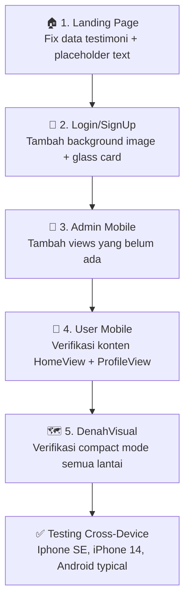

# 📱 Mobile Layout Responsive — Planning SiRuang

> **Status:** Planning / In Progress
> **Tanggal Dibuat:** 9 November 2026
> **Tujuan:** Membuat semua halaman SiRuang fully responsive di perangkat mobile, dengan tampilan dan konten yang **identik** dengan versi Web & Tab — hanya tata letak yang disesuaikan. Tidak ada perubahan pada file `Web&Tab`.

---

## 🚨 Aturan Utama (WAJIB DIPATUHI)

> [!CAUTION]
> **DILARANG KERAS menyentuh file `Web&Tab` manapun!**
> Semua improvement hanya dilakukan di file `Mobile/MobileLayout.tsx` masing-masing section.
> File Web&Tab adalah "source of truth" — kita cukup import komponen dari sana dan atur ulang tata letaknya untuk mobile.

| ✅ Boleh | ❌ Dilarang |
|---|---|
| Edit file `Mobile/MobileLayout.tsx` | Edit file `Web&Tab/WebTabLayout.tsx` |
| Import komponen dari `Web&Tab` | Mengubah logika bisnis apapun |
| Tambah komponen baru di folder `Mobile/` | Mengubah styling Web&Tab |
| Gunakan BottomNav di halaman yang perlu navigasi | Duplikasi komponen tanpa alasan |

---

## 📐 Strategi Responsif Global

- **Breakpoint Mobile:** `< 768px` (semua yang di bawah tablet)
- **Komponen Shared:** Import dari `Web&Tab` lalu wrap dengan layout mobile-friendly
- **Bottom Nav Bar:** Digunakan di halaman **Admin** dan **User** (bukan di Landing & Login)
- **Landing Page:** No BottomNav — cukup rapikan layout vertikal dengan Navbar yang sudah ada
- **Login/Auth:** No BottomNav — cukup atur animasi & form untuk layar kecil
- **DenahVisual:** No BottomNav — gunakan fullscreen compact mode yang sudah ada

---

## 📋 Daftar Halaman & Status

| No | Section | File Mobile | Status | Prioritas |
|---|---|---|---|---|
| 1 | 🏠 Landing Page | `LandingPage/Mobile/MobileLayout.tsx` | 🔄 Perlu Review | 1 |
| 2 | 🔐 Login (Auth) | `Authentication/Mobile/Login.tsx` | 🔄 Perlu Review | 2 |
| 3 | 📝 SignUp (Auth) | `Authentication/Mobile/SignUp.tsx` | 🔄 Perlu Review | 2 |
| 4 | 👑 Admin Dashboard | `Admin/Mobile/MobileLayout.tsx` | 🔄 Perlu Review | 3 |
| 5 | 👤 User Dashboard | `User/Mobile/MobileLayout.tsx` | 🔄 Perlu Review | 4 |
| 6 | 🗺️ DenahVisual LE (L1-L4) | `DenahGedungLE/Lantai*/Mobile/MobileLayout.tsx` | 🔄 Perlu Review | 5 |
| 7 | 🗺️ DenahVisual LS (L1-L4) | `DenahGedungLS/Lantai*/Mobile/MobileLayout.tsx` | 🔄 Perlu Review | 5 |
| 8 | 🗺️ DenahVisual SFD (L3,L8) | `DenahGedungSFD/Lantai*/Mobile/MobileLayout.tsx` | 🔄 Perlu Review | 5 |

**Legend:** ✅ Done | 🔄 Perlu Review | 🚧 In Progress | ❌ Belum Dikerjakan

---

## 1️⃣ Landing Page Mobile

**File:** [`LandingPage/Mobile/MobileLayout.tsx`](file:///c:/Project%20Coding%20Syafikh/Project%20Production/SiRuang/FrontEnd/src/components/LandingPage/Mobile/MobileLayout.tsx)
**Source:** [`LandingPage/Web&Tab/WebTabLayout.tsx`](file:///c:/Project%20Coding%20Syafikh/Project%20Production/SiRuang/FrontEnd/src/components/LandingPage/Web&Tab/WebTabLayout.tsx)

### Kondisi Saat Ini
- File Mobile sudah ada dan cukup lengkap
- Sudah menggunakan import komponen dari `Web&Tab` (`FiturUtamaCards`, `CaraKerjaSection`, `FloorPreviewModal`, `DotIndicator`, `Reveal`, `FLOOR_MAPS_REGISTRY`)
- TestimonialCarousel mobile sudah ada tapi **data quote masih Lorem Ipsum** — harus disamakan dengan versi Web (pakai data real dari `testimonials` di WebTabLayout)
- Sudah ada komponen `Navbar` dan `Footer` variant mobile

### Yang Harus Diperbaiki

#### 1.1 Sinkronisasi Data Testimoni
- **Problem:** `MobileLayout.tsx` punya data testimoni hardcoded dengan quote Lorem Ipsum
- **Fix:** Import `testimonials` data dari `Web&Tab/WebTabLayout.tsx` atau duplikasi data yang sama persis
- **Detail:** Setiap testimoni harus punya field `src`, `quote`, `role`, dan `focusX` seperti versi web

```tsx
// SEBELUM (mobile - data placeholder)
const QUOTE = '"Lorem ipsum dolor sit amet..."';
const testimonials = [1, 2, 3, 4, 5].map((n) => ({
  src: `/SolusiMasalah/${n}.png`,
  quote: QUOTE,
}));

// SESUDAH (mobile - data real sama persis dengan web)
// Import atau duplikasi dari WebTabLayout:
const testimonials = [
  { src: '/SolusiMasalah/1.png', role: 'PJ Kelas', focusX: 50, quote: '"Dulu harus keliling gedung..."' },
  // ... dst
];
```

#### 1.2 Tampilkan Role di Testimoni Mobile
- **Problem:** Kartu testimoni mobile tidak menampilkan field `role` (hanya foto + quote)
- **Fix:** Tambahkan `<p>` untuk role seperti versi web — tampil di bawah quote saat kartu aktif
- **Posisi:** Di dalam slot carousel, tampilkan role di bawah quote text

#### 1.3 Teks "Responsive Website" Section
- **Problem:** Ada teks hardcoded "Lorem ipsum dolor sit" dan link "Lorem ipsum" masih placeholder
- **Fix:** Samakan teks dengan versi web — cek konten section Responsive Website di WebTabLayout
- **Target:** Teks deskripsi dan label tombol harus identik dengan Web

#### 1.4 Teks "Masalah yang Diselesaikan" Section
- **Problem:** Ada teks "Lorem Ipsum dolor sit" yang masih placeholder di subtitle section
- **Fix:** Ambil teks yang benar dari `WebTabLayout.tsx` section Masalah/Solusi

#### 1.5 Teks "Data Real-Time" Section
- **Problem:** Ada deskripsi Lorem Ipsum placeholder di bawah judul "Data Real-Time"
- **Fix:** Ganti dengan teks konten yang benar dari Web&Tab (atau teks yang sesuai konteks)

> [!NOTE]
> Komponen `FiturUtamaCards`, `CaraKerjaSection`, dan `FloorPreviewModal` sudah di-import dari Web&Tab — tidak perlu diubah. Yang perlu difix hanya data/konten yang masih placeholder.

---

## 2️⃣ Login & SignUp (Authentication) Mobile

**File Login:** [`Authentication/Mobile/Login.tsx`](file:///c:/Project%20Coding%20Syafikh/Project%20Production/SiRuang/FrontEnd/src/components/Authentication/Mobile/Login.tsx)
**File SignUp:** [`Authentication/Mobile/SignUp.tsx`](file:///c:/Project%20Coding%20Syafikh/Project%20Production/SiRuang/FrontEnd/src/components/Authentication/Mobile/SignUp.tsx)
**Source Web:** [`Authentication/Web&Tab/Login.tsx`](file:///c:/Project%20Coding%20Syafikh/Project%20Production/SiRuang/FrontEnd/src/components/Authentication/Web&Tab/Login.tsx)

### Kondisi Saat Ini
Halaman Login mobile sudah ada, punya:
- Logo SiRuang di tengah atas
- Form NIM/NIP + Password
- CAPTCHA verification
- Animasi framer-motion (fade in)
- Background gradient tipis

Halaman Web&Tab punya:
- Background image penuh `BackgroundLogSign.png` dengan brightness/contrast filter
- Dark overlay layer `bg-slate-950/75`
- Dua blur glow element (kanan atas & kiri bawah)
- Left Panel: Form login + background texture `Batik.png`
- Right Panel: Logo SiRuang besar + tombol Daftar (hidden di mobile)
- Animasi `motion.div` dengan opacity + y transition

### Yang Harus Diperbaiki

#### 2.1 Background Image Latar
- **Problem:** Mobile login **tidak punya background image** `BackgroundLogSign.png`
- **Fix:** Tambahkan background image yang sama dengan brightness & filter yang sama
- **Detail:**
```tsx
// Tambahkan di root div login mobile:
<div
  className="absolute inset-0 z-0 pointer-events-none bg-cover bg-center bg-no-repeat"
  style={{
    backgroundImage: `url('/BackgroundLogSign.png')`,
    filter: 'brightness(0.6) contrast(1.15)',
  }}
/>
// Dark overlay:
<div className="absolute inset-0 z-0 pointer-events-none bg-slate-950/75" />
```

#### 2.2 Glow Elements
- **Problem:** Mobile tidak punya blur glow elements biru
- **Fix:** Tambahkan dua glow circles yang sama seperti web (tapi boleh sedikit disesuaikan ukurannya untuk mobile)

#### 2.3 Card Container Login
- **Problem:** Mobile login tidak punya card glass container seperti web (`bg-white/60 backdrop-blur-3xl rounded-[48px]`)
- **Fix:** Bungkus form dalam glass card — tapi karena mobile layar kecil, gunakan card penuh layar atau card yang lebih compact
- **Detail:** Tambahkan `backdrop-blur` dan border glass effect yang serupa

#### 2.4 Texture Batik pada Form
- **Problem:** Form mobile tidak punya texture `Batik.png` di background form area
- **Fix:** Tambahkan texture Batik dengan opacity yang sama seperti web

#### 2.5 Animasi Masuk
- **Problem:** Web punya `initial={{ opacity: 0, y: 20 }}` dan Right Panel punya `initial={{ opacity: 0, scale: 0.9 }}`
- **Fix:** Pastikan mobile tetap pakai animasi serupa (sudah ada tapi pastikan parameternya sama)
- **Logo:** Di mobile, karena tidak ada Right Panel, logo tampil di atas form dengan animasi `scale` yang sama

#### 2.6 Teks & CTA
- Pastikan teks "Selamat Datang" (atau "Masuk Akun") konsisten
- Pastikan label "MASUK KE SISTEM" atau "MASUK SEKARANG" sesuai styling web
- Pastikan link "Daftar Sekarang" ada dan bisa diakses

> [!NOTE]
> Karena mobile tidak punya right panel, logo SiRuang yang di Web ada di kanan panel perlu dimunculkan di bagian atas form mobile. Logo sudah ada di mobile saat ini — pastikan ukuran dan animasinya proporsional.

---

## 3️⃣ Admin Dashboard Mobile

**File:** [`Admin/Mobile/MobileLayout.tsx`](file:///c:/Project%20Coding%20Syafikh/Project%20Production/SiRuang/FrontEnd/src/components/Admin/Mobile/MobileLayout.tsx)
**Source Web:** [`Admin/Web&Tab/WebTabLayout.tsx`](file:///c:/Project%20Coding%20Syafikh/Project%20Production/SiRuang/FrontEnd/src/components/Admin/Web&Tab/WebTabLayout.tsx)

### Struktur Komponen Admin Mobile
```
MobileLayout.tsx
├── MobileHeader.tsx          ← Header fixed dengan nama admin + AI toggle
├── MobileDashboardView.tsx   ← Halaman Home (statistik + sistem)
├── MobileChatListView.tsx    ← List room chat (unreading/reading)
├── MobileChatRoomView.tsx    ← Room chat terbuka
└── MobileBottomNav.tsx       ← Bottom Navigation
```

### Bottom Nav Admin (Sudah Ada)
```
[ Home ] [ ⏰ Unreading ] [ 📢 FAB Blast ] [ ✅ Reading ] [ Keluar ]
```

### Kondisi Saat Ini
Admin Mobile sudah cukup lengkap strukturnya. Yang perlu dikonfirmasi:

#### 3.1 Semua View dari Web&Tab Sudah Ada
Cek bahwa semua fitur web ada di mobile:

| Fitur Web | Komponen Mobile | Status |
|---|---|---|
| Dashboard stats (Users, Latency) | `MobileDashboardView` | ✅ |
| Chat rooms list (unreading/reading) | `MobileChatListView` | ✅ |
| Chat room view + reply | `MobileChatRoomView` | ✅ |
| AI Toggle | `MobileHeader` | ✅ |
| Blast/Bless Chat (FAB) | `MobileBottomNav` FAB | ✅ |
| Bulk delete mode | `MobileHeader` delete mode | ✅ |
| Template popup | `TemplatePopupModal` | ✅ |
| File preview modal | `FilePreviewModal` | ✅ |
| Search room | `MobileHeader` search | ✅ |
| Profile admin | ❓ Perlu dicek | 🔄 |
| Role Access View | ❓ Belum ada di mobile | ❌ |
| Manajemen Akun View | ❓ Belum ada di mobile | ❌ |
| Relasi Mata Kuliah View | ❓ Belum ada di mobile | ❌ |

#### 3.2 Views yang Belum Ada di Mobile Admin
- **`RoleAccessView`** — di web ada menu Role Access
- **`ManajemenAkunView`** — di web ada menu Manajemen Akun
- **`RelasiMataKuliahView`** — di web ada menu Relasi Mata Kuliah
- **`AdminProfile`** — di web ada halaman profile admin

**Rekomendasi Fix:**
Tambahkan tab baru di BottomNav atau buat menu tambahan di MobileHeader untuk navigasi ke view-view tersebut. Contoh:
```
Bottom Nav Admin (Updated):
[ 🏠 Home ] [ 💬 Chat ] [ 📢 FAB ] [ ⚙️ Menu ] [ 👤 Profil ]
```
Di mana tab "Menu" membuka slide panel atau bottom sheet untuk RoleAccess, ManajemenAkun, dan RelasiMataKuliah.

#### 3.3 Pastikan AnimatePresence Smooth
- Semua transisi antar view harus smooth menggunakan `AnimatePresence` yang sudah ada
- Tidak ada flash/jump saat berganti tab

---

## 4️⃣ User Dashboard Mobile

**File:** [`User/Mobile/MobileLayout.tsx`](file:///c:/Project%20Coding%20Syafikh/Project%20Production/SiRuang/FrontEnd/src/components/User/Mobile/MobileLayout.tsx)
**Source Web:** [`User/Web&Tab/WebTabLayout.tsx`](file:///c:/Project%20Coding%20Syafikh/Project%20Production/SiRuang/FrontEnd/src/components/User/Web&Tab/WebTabLayout.tsx)

### Struktur Komponen User Mobile
```
MobileLayout.tsx
├── MobileHomeView.tsx          ← Tampilan home user
├── MobileChatListView.tsx      ← List room chat
├── MobileChatRoomView.tsx      ← Room chat terbuka
├── MobileProfileView.tsx       ← Halaman profil user
└── MobileBottomNav.tsx         ← Bottom Navigation
```

### Bottom Nav User (Sudah Ada)
```
[ 🏠 Home ] [ 💬 Chats ] [ 👤 Profil ]
```

### Kondisi Saat Ini

#### 4.1 Mapping Fitur Web ke Mobile

| Fitur Web | Komponen Mobile | Status |
|---|---|---|
| Home/Landing user (denah grid + chat) | `MobileHomeView` | ✅ |
| Chat room list | `MobileChatListView` | ✅ |
| Chat room + kirim pesan | `MobileChatRoomView` | ✅ |
| Profile + logout | `MobileProfileView` | ✅ |
| Template popup | `UserTemplatePopupModal` | ✅ |
| File preview | `FilePreviewModal` | ✅ |
| Image lightbox | Di `MobileLayout` | ✅ |
| Unread count badge | `MobileBottomNav` | ✅ |

#### 4.2 MobileHomeView — Cek Konten
Pastikan `MobileHomeView` menampilkan semua yang ada di `UserLandingView.tsx` (web):
- Grid denah gedung (LE, LS, SFD)
- Shortcut ke chat
- Status badge unread
- Greeting user name

#### 4.3 MobileProfileView — Cek Konten
Pastikan `MobileProfileView` menampilkan semua yang ada di profil web:
- Nama user + avatar
- Edit profil (jika ada di web)
- Tombol logout

---

## 5️⃣ DenahVisual Mobile (LE, LS, SFD)

**Files:** `DenahGedungLE/Lantai*/Mobile/MobileLayout.tsx` × 10 lantai total (LE×4, LS×4, SFD×2)
**Source Web:** `DenahGedungLE/Lantai*/Web&Tab/Web&TabLayout.tsx`

### Kondisi Saat Ini
Semua file `MobileLayout.tsx` di DenahVisual saat ini **hanya berisi 19 baris** — mereka memanggil `LePage({ compact: true })` atau equivalentnya.

```tsx
// Contoh current: DenahGedungLE/Lantai1/Mobile/MobileLayout.tsx
import React from 'react';
import { LePage } from '../Web&Tab/Web&TabLayout';

export default function MobileLayout() {
  return <LePage compact />;
}
```

### Strategi Mobile Denah

Pendekatan compact mode sudah benar secara konsep. Yang perlu dikonfirmasi:

#### 5.1 Compact Mode untuk Semua Lantai
Pastikan setiap lantai di semua gedung menggunakan `compact` prop yang sesuai:
- `compact={true}` → kartu ruangan tampil di bawah peta (bukan overlay)
- Swipe/scroll yang nyaman di layar kecil
- Tombol "Kembali ke Pilih Lantai" tetap terlihat

#### 5.2 RoomFlow di Mobile
`RoomFlow` (Jadwal → Fasilitas → Lokasi → Booking) sudah full-screen overlay — itu sudah bagus untuk mobile. Pastikan:
- Header navigasi step (Denah/Jadwal/Fasilitas/Lokasi/Booking) tidak overflow
- Konten scroll lancar di dalam `RoomFlow`
- Tombol "Kembali" dan "Lanjut" mudah dijangkau jempol (cukup besar, posisi bawah)

#### 5.3 Header Fixed Denah di Mobile
Di `LePage`, header ada `fixed inset-x-0 top-0 z-30`. Pastikan di mobile:
- Tinggi header tidak terlalu makan layar
- Teks "Gedung L Elektro" + "Lantai N" tidak overlap dengan logo SiRuang
- Logo SiRuang tetap proporsional

#### 5.4 Peta Interaktif di Mobile
- Layar kecil → peta lebih kecil, tapi tetap bisa di-tap untuk memilih ruangan
- Hover tooltip tidak muncul di mobile (sudah benar — event hover tidak ada di touch)
- Kartu ruangan di mode compact (di bawah peta) harus full-width dan scrollable

#### 5.5 Legenda di Mobile
Legenda warna (Kosong/Pengajuan/Dipakai/Fasilitas) harus tetap terbaca.
Jika terlalu sempit, bisa dibuat 2 baris.

---

## 🎨 Komponen Shared yang Perlu Diperhatikan

### Navbar Mobile
**File:** [`LandingPage/Navbar.tsx`](file:///c:/Project%20Coding%20Syafikh/Project%20Production/SiRuang/FrontEnd/src/components/LandingPage/Navbar.tsx)
- Navbar sudah ada variant `mobile` — pastikan hamburger menu berfungsi
- Link navigasi (Home, Fitur, Cara Kerja, Masuk) harus bisa diakses

### Footer Mobile
**File:** [`LandingPage/Footer.tsx`](file:///c:/Project%20Coding%20Syafikh/Project%20Production/SiRuang/FrontEnd/src/components/LandingPage/Footer.tsx)
- Footer sudah ada variant `mobile` — pastikan link tidak overflow

### AppLoader Mobile
**File:** [`LandingPage/AppLoader.tsx`](file:///c:/Project%20Coding%20Syafikh/Project%20Production/SiRuang/FrontEnd/src/components/LandingPage/AppLoader.tsx)
- Loader sudah ada — pastikan smooth di semua device

---

## 🔄 Alur Pengerjaan (Urutan Prioritas)



---

## 📝 Checklist Per Section

### Landing Page
- [ ] Sinkronisasi data testimoni (quote + role + focusX)
- [ ] Tampilkan field `role` di carousel mobile
- [ ] Fix teks "Data Real-Time" (hapus Lorem Ipsum)
- [ ] Fix teks section "Responsive Website" (hapus Lorem Ipsum)
- [ ] Fix teks subtitle "Masalah yang Diselesaikan" (hapus Lorem Ipsum)
- [ ] Fix link "Lorem ipsum" di section Responsive Website

### Login Mobile
- [ ] Tambah `BackgroundLogSign.png` sebagai background
- [ ] Tambah `bg-slate-950/75` dark overlay
- [ ] Tambah dua glow elements (kanan atas, kiri bawah)
- [ ] Tambah texture `Batik.png` pada form area
- [ ] Pastikan glass card effect ada
- [ ] Pastikan animasi framer-motion sama dengan web
- [ ] Pastikan logo SiRuang tampil dengan ukuran proporsional

### SignUp Mobile
- [ ] Review dan sinkronkan dengan `Authentication/Web&Tab/SignUp.tsx`
- [ ] Background sama dengan login
- [ ] Semua field form identik

### Admin Mobile
- [ ] Cek profile admin view
- [ ] Tambah akses ke RoleAccessView (dari menu/tab)
- [ ] Tambah akses ke ManajemenAkunView (dari menu/tab)
- [ ] Tambah akses ke RelasiMataKuliahView (dari menu/tab)
- [ ] Pastikan semua modal & overlay berfungsi
- [ ] Test AI toggle on/off
- [ ] Test blast chat
- [ ] Test bulk delete

### User Mobile
- [ ] Verifikasi `MobileHomeView` menampilkan semua konten web
- [ ] Verifikasi `MobileProfileView` menampilkan semua konten web
- [ ] Pastikan unread badge badge di BottomNav akurat
- [ ] Test kirim pesan + attachment
- [ ] Test template popup
- [ ] Test image lightbox

### DenahVisual (semua lantai)
- [ ] Pastikan header tidak overflow di mobile
- [ ] Pastikan peta bisa di-tap dengan nyaman
- [ ] Pastikan kartu ruangan tampil di bawah peta (compact mode)
- [ ] Pastikan RoomFlow fullscreen berfungsi smooth
- [ ] Pastikan step navigator Jadwal/Fasilitas/Lokasi/Booking tidak overflow
- [ ] Pastikan legenda warna terbaca
- [ ] Test di LE Lantai 1-4
- [ ] Test di LS Lantai 1-4
- [ ] Test di SFD Lantai 3 & 8

---

## 🗂️ File Map Referensi

```
FrontEnd/src/components/
│
├── LandingPage/
│   ├── Mobile/
│   │   └── MobileLayout.tsx          ← EDIT INI
│   └── Web&Tab/
│       └── WebTabLayout.tsx          ← JANGAN DISENTUH (source)
│
├── Authentication/
│   ├── Mobile/
│   │   ├── Login.tsx                 ← EDIT INI
│   │   └── SignUp.tsx                ← EDIT INI
│   └── Web&Tab/
│       ├── Login.tsx                 ← JANGAN DISENTUH
│       ├── SignUp.tsx                ← JANGAN DISENTUH
│       └── AuthSlider.tsx            ← JANGAN DISENTUH
│
├── Admin/
│   ├── Mobile/
│   │   ├── MobileLayout.tsx          ← EDIT INI
│   │   └── components/
│   │       ├── MobileBottomNav.tsx   ← EDIT INI (tambah tab jika perlu)
│   │       ├── MobileDashboardView.tsx
│   │       ├── MobileHeader.tsx
│   │       ├── MobileChatListView.tsx
│   │       └── MobileChatRoomView.tsx
│   └── Web&Tab/
│       └── WebTabLayout.tsx          ← JANGAN DISENTUH
│
├── User/
│   ├── Mobile/
│   │   ├── MobileLayout.tsx          ← EDIT INI
│   │   └── components/
│   │       ├── MobileBottomNav.tsx
│   │       ├── MobileHomeView.tsx    ← EDIT INI (sinkronisasi konten)
│   │       ├── MobileChatListView.tsx
│   │       ├── MobileChatRoomView.tsx
│   │       └── MobileProfileView.tsx ← EDIT INI (sinkronisasi konten)
│   └── Web&Tab/
│       └── WebTabLayout.tsx          ← JANGAN DISENTUH
│
└── DenahVisual/
    ├── DenahGedungLE/Lantai{1-4}/
    │   ├── Mobile/MobileLayout.tsx   ← EDIT JIKA PERLU
    │   └── Web&Tab/Web&TabLayout.tsx ← JANGAN DISENTUH
    ├── DenahGedungLS/Lantai{1-4}/
    │   ├── Mobile/MobileLayout.tsx   ← EDIT JIKA PERLU
    │   └── Web&Tab/Web&TabLayout.tsx ← JANGAN DISENTUH
    └── DenahGedungSFD/Lantai{3,8}/
        ├── Mobile/MobileLayout.tsx   ← EDIT JIKA PERLU
        └── Web&Tab/Web&TabLayout.tsx ← JANGAN DISENTUH
```

---

## 🎯 Target Akhir

Setelah semua selesai:
1. **Buka di HP** → Tampilan mobile yang clean, semua konten sama dengan web
2. **Landing Page** → Semua teks real (tidak ada Lorem Ipsum), testimoni lengkap dengan role
3. **Login** → Background foto kampus + glass card effect + animasi smooth
4. **Admin** → BottomNav berfungsi + semua view web bisa diakses
5. **User** → BottomNav berfungsi + home/profile/chat lengkap
6. **Denah** → Peta bisa di-tap, RoomFlow fullscreen, navigasi step lancar

> [!TIP]
> Saat mengerjakan, selalu buka dua file berdampingan: `Web&Tab` sebagai referensi dan `Mobile` sebagai file yang diedit. Pastikan setiap elemen visual di web ada representasinya di mobile.

---

*Planning ini adalah living document — update status checklist setiap kali ada progress.*

