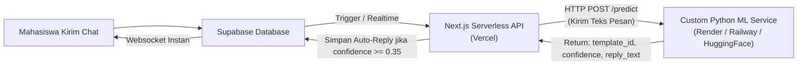

# 📘 Panduan & Rencana Kerja Refactor Database SiRuang: MySQL (XAMPP) ➔ Supabase (PostgreSQL)

Dokumen ini berisi arsitektur, rencana migrasi, rancangan skema database baru, perubahan kode pada **Backend (Go/Gin)**, perubahan antarmuka dan logika pada **Frontend (Next.js/React/TypeScript)**, serta instruksi konfigurasi pada **Supabase**.

---

## Daftar Isi
1. [Ringkasan Proyek & Tujuan Refactor](#1-ringkasan-proyek--tujuan-refactor)
2. [Konfigurasi Awal Supabase (Menjawab Pertanyaan Setup)](#2-konfigurasi-awal-supabase-menjawab-pertanyaan-setup)
3. [Perbandingan Arsitektur Database: MySQL vs PostgreSQL](#3-perbandingan-arsitektur-database-mysql-vs-postgresql)
4. [Skema Lengkap Database Supabase (SiRuang)](#4-skema-lengkap-database-supabase-siruang)
5. [Rencana Perubahan Sistem Autentikasi (NIM/NIP) & Role](#5-rencana-perubahan-sistem-autentikasi-nimnip--role)
6. [Daftar Perubahan Detail pada Backend (Go)](#6-daftar-perubahan-detail-pada-backend-go)
7. [Daftar Perubahan Detail pada Frontend (Next.js)](#7-daftar-perubahan-detail-pada-frontend-nextjs)
8. [Tahapan Eksekusi Step-by-Step](#8-tahapan-eksekusi-step-by-step)
9. [Matriks Pengujian & Verifikasi (Quality Assurance)](#9-matriks-pengujian--verifikasi-quality-assurance)
10. [Rencana Rollback & Mitigasi Risiko](#10-rencana-rollback--mitigasi-risiko)

---

## 1. Ringkasan Proyek & Tujuan Refactor

### Kondisi Saat Ini (Current State)
- **Database Lama**: MySQL / MariaDB (dijalankan via XAMPP lokal), nama database: `help_desk_admisi`.
- **Backend**: Golang (Gin Framework) berjalan pada port `8080`, menggunakan driver `github.com/go-sql-driver/mysql`.
- **Frontend**: Next.js (TypeScript / Tailwind CSS) berjalan pada port `3000`.
- **Machine Learning Service**: Python FastAPI / Flask pada port `8000`.
- **Sistem Login**: Menggunakan `gmail`, `password`, dan `captcha`.
- **Role Eksisting**: `admin` dan `user`.

### Sasaran Refactor (Target State)
1. **Pindah Database**: Dari MySQL XAMPP ke Cloud Database **Supabase (PostgreSQL)**.
2. **Kredensial Database**:
   - **Nama Database Proyek**: `SiRuang`
   - **Password Database**: `SiRuang_UNJ`
   - **Region**: Asia Pacific (Singapore: `ap-southeast-1` / Jakarta jika tersedia)
3. **Autentikasi Baru**:
   - Mahasiswa: Menggunakan **NIM** (Nomor Induk Mahasiswa).
   - Dosen: Menggunakan **NIP** (Nomor Induk Pegawai).
   - Admin: Menggunakan **NIP** / User ID Khusus.
   - Kolom `gmail` pada seluruh basis data dan API digantikan oleh konsep universal: `identifier` dengan keterangan tipe `identifier_type` (`nim` atau `nip`).
4. **Ekspansi Role**:
   - Role baru yang didaftarkan pada database ENUM:
     - `admin`
     - `user` (Mahasiswa reguler)
     - `dosen` (Staf Pengajar - role persiapan/kosongan)
     - `pj_kelas` (Penanggung Jawab Kelas - role persiapan/kosongan)

---

## 2. Konfigurasi Awal Supabase (Menjawab Pertanyaan Setup)

Ketika membuat project baru atau mengonfigurasi API pada Supabase Dashboard, terdapat 3 opsi penting:

```
┌────────────────────────────────────────────────────────────────────────┐
│ 1. Enable Data API                                                     │
│    "Autogenerate a RESTful API for your public schema..."              │
│    REKOMENDASI: [ AKTIFKAN / ENABLE ]                                  │
├────────────────────────────────────────────────────────────────────────┤
│ 2. Automatically expose new tables                                     │
│    "Grants privileges to Data API roles by default..."                 │
│    REKOMENDASI: [ MATIKAN / DISABLE ]                                  │
├────────────────────────────────────────────────────────────────────────┤
│ 3. Enable automatic RLS (Row Level Security)                           │
│    "Create an event trigger that automatically enables Row Level       │
│     Security on all new tables in the public schema..."                │
│    REKOMENDASI: [ AKTIFKAN / ENABLE ]                                  │
└────────────────────────────────────────────────────────────────────────┘
```

### Penjelasan & Alasan Teknis:

1. **Enable Data API (Wajib/Disarankan: ENABLE)**
   - **Alasan**: Backend Go menghubungkan langsung via protokol PostgreSQL standar (`postgres://...` port 5432 atau 6543 pooler). Namun, mengaktifkan Data API memberikan fleksibilitas tinggi jika sewaktu-waktu ingin membaca data langsung dari client-side Next.js dengan `@supabase/supabase-js`, mengecek data di table editor, atau memanfaatkan fitur Supabase Realtime (Websocket) untuk chat.

2. **Automatically expose new tables (Disarankan: DISABLE)**
   - **Alasan**: Menghindari kebocoran data (*data leakage*). Jika diaktifkan, setiap kali tabel baru dibuat (misal tabel `authentication` yang memuat password hash bcrypt), tabel tersebut otomatis dapat di-query lewat REST API publik Supabase jika RLS belum dikonfigurasi sempurna. Dengan menonaktifkannya, akses API publik dikontrol secara selektif dan manual.

3. **Enable automatic RLS (Row Level Security) (Wajib: ENABLE)**
   - **Alasan**: Standar keamanan utama Supabase. Setiap tabel yang baru dibuat akan langsung terkunci (*deny-all by default*). Backend Go yang menggunakan akun `postgres` atau *connection string direct* secara otomatis menjadi superuser/bypass RLS, sedangkan user tanpa izin tidak akan bisa membobol data dari luar.

---

## 3. Perbandingan Arsitektur Database: MySQL vs PostgreSQL

Perubahan dari MySQL (MariaDB) ke PostgreSQL membutuhkan penyesuaian sintaksis mendasar:

| Aspek | MySQL (Lama) | PostgreSQL / Supabase (Baru) | Penanganan di Go Backend |
|---|---|---|---|
| **Driver Driver** | `github.com/go-sql-driver/mysql` | `github.com/lib/pq` atau `pgx` | Ganti modul di `go.mod` & import |
| **Placeholder Query** | `?` | `$1`, `$2`, `$3`, ... | Rewrite semua string SQL query |
| **Auto Increment ID** | `INT AUTO_INCREMENT` | `SERIAL` atau `BIGSERIAL` | Menggunakan `SERIAL PRIMARY KEY` |
| **Quoting Identifier** | Backtick (\`nama_kolom\`) | Double quote (`"nama_kolom"`) / tanpa quote | Hapus backticks dari query Go |
| **Tipe Data Boolean** | `TINYINT(1)` (0 atau 1) | `BOOLEAN` (`TRUE` atau `FALSE`) | Model Go memakai `bool` native |
| **String Panjang** | `LONGTEXT` / `TEXT` | `TEXT` | `string` di Go |
| **Role / Enum** | `ENUM('admin', 'user')` | `CREATE TYPE user_role AS ENUM(...)` | Buat type enum sebelum create table |
| **Current Time** | `current_timestamp()` | `NOW()` / `CURRENT_TIMESTAMP` | Gunakan `NOW()` standar Postgres |
| **Nilai Null** | `IFNULL(a, b)` | `COALESCE(a, b)` | Ganti `IFNULL` ke `COALESCE` |
| **Pagination** | `LIMIT ?, ?` (offset, limit) | `LIMIT $1 OFFSET $2` | Sesuaikan urutan limit & offset |

---

## 4. Skema Lengkap Database Supabase (SiRuang)

Salin (*copy*) seluruh skrip SQL di bawah ini dan jalankan langsung pada menu **SQL Editor** di Dashboard Supabase:

```sql
-- ========================================================
-- SIRUANG DATABASE SCHEMA (POSTGRESQL / SUPABASE)
-- Refactor dari help_desk_admisi MySQL
-- ========================================================

-- 1. Bersihkan tabel lama jika ada (opsional / fresh start)
DROP TABLE IF EXISTS chat_messages CASCADE;
DROP TABLE IF EXISTS chat_rooms CASCADE;
DROP TABLE IF EXISTS active_sessions CASCADE;
DROP TABLE IF EXISTS authentication CASCADE;
DROP TABLE IF EXISTS captcha CASCADE;

DROP TYPE IF EXISTS user_role CASCADE;
DROP TYPE IF EXISTS message_type CASCADE;

-- 2. Buat ENUM Types
-- Menambahkan role baru: dosen dan pj_kelas
CREATE TYPE user_role AS ENUM ('admin', 'user', 'dosen', 'pj_kelas');
CREATE TYPE message_type AS ENUM ('text', 'file', 'image', 'multi_file');

-- 3. Tabel: authentication
-- Perubahan: Mengganti 'gmail' menjadi 'identifier' (NIM/NIP)
CREATE TABLE authentication (
    id SERIAL PRIMARY KEY,
    username VARCHAR(100) NOT NULL,
    identifier VARCHAR(50) NOT NULL UNIQUE,          -- Menyimpan NIM atau NIP
    identifier_type VARCHAR(10) NOT NULL DEFAULT 'nim'
        CHECK (identifier_type IN ('nim', 'nip')),   -- Validasi tipe input
    password VARCHAR(255) NOT NULL,                  -- Bcrypt hash
    role user_role NOT NULL DEFAULT 'user',
    created_at TIMESTAMP WITH TIME ZONE NOT NULL DEFAULT NOW()
);

-- Indeks untuk performa lookup saat login
CREATE INDEX idx_auth_identifier ON authentication(identifier);
CREATE INDEX idx_auth_role ON authentication(role);

-- 4. Tabel: active_sessions
-- Pelacakan multi-device login berbasis NIM/NIP
CREATE TABLE active_sessions (
    id SERIAL PRIMARY KEY,
    identifier VARCHAR(50) NOT NULL,
    session_id TEXT NOT NULL,                        -- JWT Token hash/string
    last_activity TIMESTAMP WITH TIME ZONE NOT NULL DEFAULT NOW()
);

CREATE INDEX idx_sessions_identifier ON active_sessions(identifier);

-- 5. Tabel: captcha
-- Soal matematika sederhana pencegah brute-force/bot
CREATE TABLE captcha (
    kode VARCHAR(10) PRIMARY KEY,
    pertanyaan VARCHAR(50) NOT NULL,
    jawaban VARCHAR(10) NOT NULL
);

-- 6. Tabel: chat_rooms
-- Ruang obrolan antara mahasiswa/dosen dengan HelpDesk/Admin
CREATE TABLE chat_rooms (
    id SERIAL PRIMARY KEY,
    user_identifier VARCHAR(50) NOT NULL,           -- NIM / NIP pemilik room
    last_message TEXT,
    updated_at TIMESTAMP WITH TIME ZONE NOT NULL DEFAULT NOW(),
    is_marked_unread BOOLEAN NOT NULL DEFAULT FALSE
);

CREATE INDEX idx_rooms_user_identifier ON chat_rooms(user_identifier);

-- 7. Tabel: chat_messages
-- Riwayat pesan chat
CREATE TABLE chat_messages (
    id SERIAL PRIMARY KEY,
    room_id INTEGER NOT NULL REFERENCES chat_rooms(id) ON DELETE CASCADE,
    sender_identifier VARCHAR(50) NOT NULL,          -- NIM / NIP pengirim
    message TEXT NOT NULL,
    message_type message_type NOT NULL DEFAULT 'text',
    created_at TIMESTAMP WITH TIME ZONE NOT NULL DEFAULT NOW(),
    is_read BOOLEAN NOT NULL DEFAULT FALSE
);

CREATE INDEX idx_messages_room_id ON chat_messages(room_id);
CREATE INDEX idx_messages_sender_identifier ON chat_messages(sender_identifier);

-- ========================================================
-- DATA AWAL (SEED DATA)
-- ========================================================

-- Isi Soal Captcha
INSERT INTO captcha (kode, pertanyaan, jawaban) VALUES
('C001', '2 + 3 = ?', '5'),
('C002', '7 - 4 = ?', '3'),
('C003', '3 x 2 = ?', '6'),
('C004', '8 / 2 = ?', '4'),
('C005', '5 + 1 = ?', '6'),
('C006', '9 - 5 = ?', '4'),
('C007', '4 x 3 = ?', '12'),
('C008', '6 / 3 = ?', '2'),
('C009', '1 + 7 = ?', '8'),
('C010', '10 - 6 = ?', '4');

-- Akun Default Administrator
-- Identifier: 198501012010121001 (NIP Admin)
-- Password: AdminDev1 (Bcrypt Hash)
INSERT INTO authentication (username, identifier, identifier_type, password, role)
VALUES (
    'Admin UNJ',
    '198501012010121001',
    'nip',
    '$2a$10$XLxJ1t0Hoh3gk.wjM2bOzu4hVS.GqkJk0bYcJTz6bSOsPmhSxJGRK',
    'admin'
);

-- Akun Sampel Mahasiswa (User Biasa)
-- Identifier: 1313620001 (NIM Mahasiswa)
-- Password: User1234
INSERT INTO authentication (username, identifier, identifier_type, password, role)
VALUES (
    'Mahasiswa Demo',
    '1313620001',
    'nim',
    '$2a$10$0zT5zR.qfO6lEceWqZlUreF/rA781Hj6Vb44Qp51kX5JcTjV0/lWC',
    'user'
);

-- Akun Sampel Dosen (Role Persiapan)
-- Identifier: 197805152005011002 (NIP Dosen)
-- Password: User1234
INSERT INTO authentication (username, identifier, identifier_type, password, role)
VALUES (
    'Dosen Demo',
    '197805152005011002',
    'nip',
    '$2a$10$0zT5zR.qfO6lEceWqZlUreF/rA781Hj6Vb44Qp51kX5JcTjV0/lWC',
    'dosen'
);

-- Akun Sampel PJ Kelas (Role Persiapan)
-- Identifier: 1313620099 (NIM PJ Kelas)
-- Password: User1234
INSERT INTO authentication (username, identifier, identifier_type, password, role)
VALUES (
    'PJ Kelas Demo',
    '1313620099',
    'nim',
    '$2a$10$0zT5zR.qfO6lEceWqZlUreF/rA781Hj6Vb44Qp51kX5JcTjV0/lWC',
    'pj_kelas'
);

-- ========================================================
-- KEAMANAN: ROW LEVEL SECURITY (RLS)
-- ========================================================
ALTER TABLE authentication ENABLE ROW LEVEL SECURITY;
ALTER TABLE active_sessions ENABLE ROW LEVEL SECURITY;
ALTER TABLE captcha ENABLE ROW LEVEL SECURITY;
ALTER TABLE chat_rooms ENABLE ROW LEVEL SECURITY;
ALTER TABLE chat_messages ENABLE ROW LEVEL SECURITY;

-- Izinkan public membaca captcha
CREATE POLICY "Public Read Captcha" ON captcha FOR SELECT USING (true);
```

---

## 5. Rencana Perubahan Sistem Autentikasi (NIM/NIP) & Role

### 5.1 Logika Identifikasi (NIM vs NIP)
- **NIM (Nomor Induk Mahasiswa)**:
  - Karakteristik: Angka numerik, panjang umumnya 10–12 digit (contoh UNJ: `1313620001`).
  - Terikat dengan role: `user` atau `pj_kelas`.
- **NIP (Nomor Induk Pegawai)**:
  - Karakteristik: Angka numerik, panjang 18 digit (contoh ASN: `198501012010121001`) atau format NIP Karyawan/Admin khusus.
  - Terikat dengan role: `dosen` atau `admin`.

### 5.2 Alur Registrasi (SignUp)
1. Pengguna memilih tipe pendaftaran di UI:
   - **Mahasiswa**: Input berupa **NIM**. Sistem menetapkan `identifier_type = 'nim'` dan `role = 'user'`.
   - **Dosen**: Input berupa **NIP**. Sistem menetapkan `identifier_type = 'nip'` dan `role = 'dosen'`.
2. Validasi input:
   - Harus berupa digit angka (numeric only).
   - Minimal panjang karakter (misal NIM: 8–12 digit, NIP: 8–18 digit).
   - Memastikan identifier belum terdaftar di tabel `authentication`.
3. Password dienkripsi dengan **Bcrypt** (cost 10).
4. Catatan Role Khusus:
   - Role `pj_kelas` dan `admin` **tidak dibuka** melalui form pendaftaran publik demi alasan keamanan. Perubahan status menjadi `pj_kelas` dilakukan oleh Admin melalui query atau dashboard admin nantinya.

### 5.3 Alur Masuk (Login)
1. Pengguna memasukkan:
   - `identifier`: NIM atau NIP
   - `password`: Kata sandi akun
   - `captcha_jawaban`: Jawaban verifikasi matematika
2. Backend mencocokkan `identifier` pada tabel `authentication`.
3. Verifikasi password hash menggunakan `bcrypt.CompareHashAndPassword`.
4. Pembatasan Sesi Aktif (*Concurrent Sessions*):
   - **Admin**: Maksimal 4 sesi perangkat aktif bersamaan.
   - **Dosen**: Maksimal 2 sesi perangkat aktif bersamaan.
   - **Mahasiswa / PJ Kelas**: Maksimal 1 sesi perangkat aktif (login di perangkat baru otomatis memutus sesi lama).
5. Pembuatan token JWT:
   - Payload:
     ```json
     {
       "identifier": "1313620001",
       "identifier_type": "nim",
       "role": "user",
       "username": "Mahasiswa Demo",
       "exp": 1740000000
     }
     ```

---

## 6. Daftar Perubahan Detail pada Backend (Go)

### 6.1 Berkas `BackEnd/.env`
Perbarui variabel koneksi database untuk mengarah ke Supabase:

```env
# Koneksi Database Supabase (PostgreSQL)
DB_HOST=db.[PROJECT-REF].supabase.co
DB_PORT=5432
DB_USER=postgres
DB_PASSWORD=SiRuang_UNJ
DB_NAME=postgres
DB_SSLMODE=require

# Port Server Backend
SERVER_PORT=8080

# Kunci Rahasia JWT
JWT_SECRET=siruang_super_secret_jwt_key_unj_2026

# Koneksi Machine Learning
ML_SERVICE_URL=http://localhost:8000

# URL Frontend (CORS)
FRONTEND_URL=http://localhost:3000
```

> **Catatan Port Supabase**: Jika jaringan memblokir port `5432`, gunakan Supabase Connection Pooling (Session mode) pada host `aws-0-[region].pooler.supabase.com` port `6543`.

---

### 6.2 Berkas `BackEnd/go.mod`
Ganti driver MySQL dengan driver PostgreSQL:

```bash
cd BackEnd
go get github.com/lib/pq
```

Hapus ketergantungan `github.com/go-sql-driver/mysql` jika sudah tidak digunakan:
```bash
go mod tidy
```

---

### 6.3 Berkas Koneksi Database: Buat `internal/database/postgres.go`
Gantikan peran `internal/database/mysql.go` dengan file koneksi PostgreSQL:

```go
package database

import (
	"database/sql"
	"fmt"
	"log"
	"os"

	_ "github.com/lib/pq"
)

var DB *sql.DB

func InitDB() {
	host := os.Getenv("DB_HOST")
	port := os.Getenv("DB_PORT")
	user := os.Getenv("DB_USER")
	password := os.Getenv("DB_PASSWORD")
	dbname := os.Getenv("DB_NAME")
	sslmode := os.Getenv("DB_SSLMODE")
	if sslmode == "" {
		sslmode = "require"
	}

	dsn := fmt.Sprintf("host=%s port=%s user=%s password=%s dbname=%s sslmode=%s",
		host, port, user, password, dbname, sslmode)

	var err error
	DB, err = sql.Open("postgres", dsn)
	if err != nil {
		log.Fatalf("Gagal inisialisasi koneksi Postgres: %v", err)
	}

	// Konfigurasi pool koneksi
	DB.SetMaxOpenConns(25)
	DB.SetMaxIdleConns(5)

	if err = DB.Ping(); err != nil {
		log.Fatalf("Gagal ping ke Database Supabase: %v", err)
	}

	log.Println("Berhasil terhubung ke Database Supabase PostgreSQL (SiRuang)!")
}

func GetDB() *sql.DB {
	return DB
}
```

---

### 6.4 Model: `internal/models/user.go` & `chat.go`

#### `internal/models/user.go`
```go
package models

import "time"

type User struct {
	ID             int       `json:"id"`
	Username       string    `json:"username"`
	Identifier     string    `json:"identifier"`      // NIM atau NIP
	IdentifierType string    `json:"identifier_type"` // "nim" atau "nip"
	Password       string    `json:"password,omitempty"`
	Role           string    `json:"role"`            // 'admin', 'user', 'dosen', 'pj_kelas'
	CreatedAt      time.Time `json:"created_at"`
}
```

#### `internal/models/chat.go`
```go
package models

import "time"

type ChatRoom struct {
	ID             int       `json:"id"`
	UserIdentifier string    `json:"user_identifier"`
	Username       string    `json:"username"`
	LastMessage    string    `json:"last_message"`
	UpdatedAt      time.Time `json:"updated_at"`
	UnreadCount    int       `json:"unread_count"`
	IsMarkedUnread bool      `json:"is_marked_unread"`
}

type ChatMessage struct {
	ID               int       `json:"id"`
	RoomID           int       `json:"room_id"`
	SenderIdentifier string    `json:"sender_identifier"`
	Message          string    `json:"message"`
	MessageType      string    `json:"message_type"`
	CreatedAt        time.Time `json:"created_at"`
	IsRead           bool      `json:"is_read"`
}
```

---

### 6.5 Middleware: `internal/middleware/auth.go`
Ubah pembacaan token dari `gmail` menjadi `identifier`:

```go
package middleware

import (
	"database/sql"
	"net/http"
	"os"
	"strings"

	"github.com/gin-gonic/gin"
	"github.com/golang-jwt/jwt/v5"
	"helpdesk-backend/internal/database"
)

func AuthMiddleware() gin.HandlerFunc {
	return func(c *gin.Context) {
		authHeader := c.GetHeader("Authorization")
		if authHeader == "" || !strings.HasPrefix(authHeader, "Bearer ") {
			c.JSON(http.StatusUnauthorized, gin.H{"error": "Token otorisasi diperlukan"})
			c.Abort()
			return
		}

		tokenString := strings.TrimPrefix(authHeader, "Bearer ")
		secret := []byte(os.Getenv("JWT_SECRET"))

		token, err := jwt.Parse(tokenString, func(t *jwt.Token) (interface{}, error) {
			return secret, nil
		})

		if err != nil || !token.Valid {
			c.JSON(http.StatusUnauthorized, gin.H{"error": "Token tidak valid atau kadaluarsa"})
			c.Abort()
			return
		}

		claims, ok := token.Claims.(jwt.MapClaims)
		if !ok {
			c.JSON(http.StatusUnauthorized, gin.H{"error": "Klaim token tidak valid"})
			c.Abort()
			return
		}

		identifier := claims["identifier"].(string)
		role := claims["role"].(string)
		username := claims["username"].(string)

		// Verifikasi sesi aktif di tabel active_sessions (Postgres syntax: $1, $2)
		db := database.GetDB()
		var sessionExists bool
		err = db.QueryRow(
			"SELECT EXISTS(SELECT 1 FROM active_sessions WHERE identifier = $1 AND session_id = $2)",
			identifier, tokenString,
		).Scan(&sessionExists)

		if err != nil || !sessionExists {
			c.JSON(http.StatusUnauthorized, gin.H{"error": "Sesi telah berakhir atau login di perangkat lain"})
			c.Abort()
			return
		}

		// Simpan informasi user di Context Gin
		c.Set("identifier", identifier)
		c.Set("role", role)
		c.Set("username", username)
		c.Next()
	}
}

// RoleMiddleware mendukung multiple roles (misal: "admin", "dosen")
func RoleMiddleware(allowedRoles ...string) gin.HandlerFunc {
	return func(c *gin.Context) {
		userRole, exists := c.Get("role")
		if !exists {
			c.JSON(http.StatusForbidden, gin.H{"error": "Akses ditolak: role tidak ditemukan"})
			c.Abort()
			return
		}

		roleStr := userRole.(string)
		for _, allowed := range allowedRoles {
			if roleStr == allowed {
				c.Next()
				return
			}
		}

		c.JSON(http.StatusForbidden, gin.H{"error": "Akses ditolak: Anda tidak memiliki izin untuk resource ini"})
		c.Abort()
	}
}
```

---

### 6.6 Handler: `internal/handlers/auth.go`
Contoh perubahan esensial pada fungsi SignUp dan Login:

```go
// Struct Request Baru
type SignUpRequest struct {
	Username       string `json:"username" binding:"required"`
	Identifier     string `json:"identifier" binding:"required"`      // NIM / NIP
	IdentifierType string `json:"identifier_type" binding:"required"` // "nim" atau "nip"
	Password       string `json:"password" binding:"required"`
	Role           string `json:"role"`                               // Optional, default by server
}

type LoginRequest struct {
	Identifier     string `json:"identifier" binding:"required"`      // NIM / NIP
	Password       string `json:"password" binding:"required"`
	CaptchaKode    string `json:"captcha_kode" binding:"required"`
	CaptchaJawaban string `json:"captcha_jawaban" binding:"required"`
}

// Contoh Query Login di auth.go (PostgreSQL Syntax):
// 1. Validasi Captcha
// SELECT jawaban FROM captcha WHERE kode = $1

// 2. Cari Akun User
// SELECT id, username, identifier, identifier_type, password, role FROM authentication WHERE identifier = $1

// 3. Batasi Sesi Aktif
// SELECT COUNT(*) FROM active_sessions WHERE identifier = $1
// DELETE FROM active_sessions WHERE id IN (SELECT id FROM active_sessions WHERE identifier = $1 ORDER BY last_activity ASC LIMIT $2)

// 4. Catat Sesi Baru
// INSERT INTO active_sessions (identifier, session_id, last_activity) VALUES ($1, $2, NOW())
```

---

### 6.7 Perubahan Handlers Lainnya (SQL Syntax Mapping)

Periksa dan ubah seluruh query di:
- `internal/handlers/chat.go`
- `internal/handlers/admin.go`
- `internal/handlers/user.go`
- `internal/handlers/stats.go`

**Tabel Mapping Syntax Query:**

| File Handler | Query Lama (MySQL) | Query Baru (PostgreSQL Supabase) |
|---|---|---|
| `chat.go` | `SELECT id FROM chat_rooms WHERE user_gmail = ?` | `SELECT id FROM chat_rooms WHERE user_identifier = $1` |
| `chat.go` | `INSERT INTO chat_rooms (user_gmail) VALUES (?)` | `INSERT INTO chat_rooms (user_identifier) VALUES ($1) RETURNING id` |
| `chat.go` | `INSERT INTO chat_messages (room_id, sender_gmail, message, ...) VALUES (?, ?, ?, ...)` | `INSERT INTO chat_messages (room_id, sender_identifier, message, ...) VALUES ($1, $2, $3, ...)` |
| `admin.go` | `SELECT id, username, gmail, role FROM authentication` | `SELECT id, username, identifier, identifier_type, role FROM authentication` |
| `stats.go` | `COUNT(DISTINCT gmail)` | `COUNT(DISTINCT identifier)` |

---

## 7. Daftar Perubahan Detail pada Frontend (Next.js)

### 7.1 Form Login (`Web&Tab/Login.tsx` & `Mobile/Login.tsx`)
1. **Input Label & Placeholder**:
   - Ganti `Email / Gmail` menjadi `NIM atau NIP`.
   - Ubah `type="email"` menjadi `type="text"`.
   - Tambahkan atribut `inputMode="numeric"`.
2. **State Management**:
   ```typescript
   // SEBELUM:
   const [gmail, setGmail] = useState('');

   // SESUDAH:
   const [identifier, setIdentifier] = useState('');
   ```
3. **Payload Pengiriman**:
   ```typescript
   const payload = {
     identifier: identifier.trim(),
     password: password,
     captcha_kode: captchaData.kode,
     captcha_jawaban: captchaAnswer.trim(),
   };
   ```
4. **Penyimpanan LocalStorage**:
   ```typescript
   localStorage.setItem('token', res.data.token);
   localStorage.setItem('identifier', res.data.identifier);
   localStorage.setItem('identifier_type', res.data.identifier_type);
   localStorage.setItem('username', res.data.username);
   localStorage.setItem('role', res.data.role);
   ```
5. **Navigasi Berdasarkan Role**:
   ```typescript
   if (res.data.role === 'admin') {
     router.push('/admin');
   } else {
     // User, Dosen, dan PJ Kelas sementara diarahkan ke dashboard pengguna
     router.push('/user');
   }
   ```

---

### 7.2 Form Registrasi (`Web&Tab/SignUp.tsx` & `Mobile/SignUp.tsx`)
1. **Pilihan Tipe Akun (Radio / Tab Selector)**:
   - Pengguna memilih apakah mendaftar sebagai **Mahasiswa** atau **Dosen**.
2. **Dinamisasi Form**:
   ```typescript
   const [accountType, setAccountType] = useState<'nim' | 'nip'>('nim');
   const [identifier, setIdentifier] = useState('');
   const [username, setUsername] = useState('');
   const [password, setPassword] = useState('');

   // Label dinamis
   const identifierLabel = accountType === 'nim' ? 'NIM (Nomor Induk Mahasiswa)' : 'NIP (Nomor Induk Pegawai)';
   const identifierPlaceholder = accountType === 'nim' ? 'Masukkan 10 digit NIM' : 'Masukkan 18 digit NIP';
   ```
3. **Payload Pendaftaran**:
   ```typescript
   const payload = {
     username: username.trim(),
     identifier: identifier.trim(),
     identifier_type: accountType,
     password: password,
     role: accountType === 'nip' ? 'dosen' : 'user', // Otomatisasi role default
   };
   ```

---

### 7.3 Pembersihan Referensi `gmail` di Seluruh Frontend
Lakukan pencarian global pada folder `FrontEnd/src/` untuk string:
- `localStorage.getItem('gmail')` ➔ ganti ke `localStorage.getItem('identifier')`
- `user_gmail` ➔ ganti ke `user_identifier`
- `sender_gmail` ➔ ganti ke `sender_identifier`

Komponen yang terdampak:
- `components/Admin/Chat/` (Daftar room & header obrolan)
- `components/User/Chat/` (Kirim & terima pesan obrolan)
- `components/Shared/Navbar.tsx` / `Header.tsx` (Tampilan info profil)

---

## 8. Tahapan Eksekusi Step-by-Step

```
┌─────────────────────────────────────────────────────────────────┐
│ TAHAP 1: PERSIAPAN & SUPABASE SETUP                             │
│ 1.1 Buat project 'SiRuang' di Supabase (Region: Asia Pacific)   │
│ 1.2 Masukkan Database Password: 'SiRuang_UNJ'                   │
│ 1.3 Jalankan Skrip SQL pada Menu SQL Editor                     │
│ 1.4 Catat Host, User, Port, dan API Keys dari Database Settings  │
└────────────────┬────────────────────────────────────────────────┘
                 │
                 ▼
┌─────────────────────────────────────────────────────────────────┐
│ TAHAP 2: ADAPTASI BACKEND (GOLANG)                              │
│ 2.1 Update BackEnd/.env dengan host & kredensial Supabase       │
│ 2.2 Jalankan 'go get github.com/lib/pq'                         │
│ 2.3 Buat postgres.go & integrasikan di main.go                  │
│ 2.4 Update Models (User, ChatRoom, ChatMessage)                 │
│ 2.5 Update Auth Middleware & JWT Token logic                    │
│ 2.6 Ubah seluruh query MySQL ($1..$n) pada Handlers             │
│ 2.7 Jalankan 'go build' untuk memastikan compile bersih         │
└────────────────┬────────────────────────────────────────────────┘
                 │
                 ▼
┌─────────────────────────────────────────────────────────────────┐
│ TAHAP 3: ADAPTASI FRONTEND (NEXT.JS)                            │
│ 3.1 Perbarui formulir Login (NIM/NIP input)                     │
│ 3.2 Perbarui formulir SignUp (Pilihan Mahasiswa vs Dosen)       │
│ 3.3 Sesuaikan sinkronisasi localStorage                         │
│ 3.4 Perbarui komponen Chat Admin & User                         │
└────────────────┬────────────────────────────────────────────────┘
                 │
                 ▼
┌─────────────────────────────────────────────────────────────────┐
│ TAHAP 4: PENGUJIAN END-TO-END & FINISHING                       │
│ 4.1 Jalankan Backend (port 8080) & Frontend (port 3000)         │
│ 4.2 Uji registrasi Mahasiswa baru & Dosen baru                  │
│ 4.3 Uji login Admin, Mahasiswa, Dosen, PJ Kelas                 │
│ 4.4 Uji kirim pesan chat, upload gambar, & toggle AI            │
│ 4.5 Matikan Apache & MySQL pada XAMPP (verifikasi cloud DB)     │
└─────────────────────────────────────────────────────────────────┘
```

---

## 9. Matriks Pengujian & Verifikasi (Quality Assurance)

Gunakan daftar checklist ini sebelum menyatakan migrasi berhasil 100%:

### A. Autentikasi & Akun
- [ ] Pendaftaran mahasiswa baru dengan NIM berhasil tersimpan di Supabase.
- [ ] Pendaftaran dosen baru dengan NIP berhasil tersimpan di Supabase dengan role `dosen`.
- [ ] Validasi error muncul jika NIM/NIP yang sama didaftarkan ulang (*duplicate key*).
- [ ] Login mahasiswa menggunakan NIM + Password + Captcha berhasil.
- [ ] Login dosen menggunakan NIP + Password + Captcha berhasil.
- [ ] Login admin menggunakan NIP Admin default (`198501012010121001` / `AdminDev1`) berhasil diarahkan ke `/admin`.
- [ ] Logout menghapus token dari `active_sessions` di Supabase.
- [ ] Pembatasan concurrent login bekerja (mahasiswa login di tab/browser lain otomatis memutus sesi pertama).

### B. Fitur HelpDesk & Chat
- [ ] Mahasiswa membuka chat ➔ Room baru otomatis terbuat di tabel `chat_rooms` Supabase.
- [ ] Mahasiswa mengirim teks pesan ➔ Tersimpan di `chat_messages`.
- [ ] Admin menerima dan dapat membalas pesan mahasiswa secara realtime/polling.
- [ ] Status baca (`is_read`) berubah menjadi `true` saat pesan dibuka.
- [ ] Fitur broadcast admin berfungsi ke seluruh room.
- [ ] Toggle AI auto-response tetap dapat dikontrol dari dashboard admin.

### C. Infrastruktur & Independensi
- [ ] Matikan MySQL pada XAMPP Control Panel.
- [ ] Pastikan seluruh aplikasi Backend dan Frontend tetap berjalan normal tanpa error database, membuktikan ketergantungan pada XAMPP lokal telah terputus sepenuhnya.

---

## 10. Rencana Rollback & Mitigasi Risiko

Apabila dalam proses eksekusi terjadi kendala jaringan (misalnya kuota/koneksi lambat ke Supabase) atau kebutuhan mendesak untuk kembali sementara ke kondisi awal:

1. **Backup File Asli**:
   - Backup file `.env`, `internal/database/mysql.go`, dan `internal/handlers/auth.go` sebelum diedit.
2. **Peralihan Kembali Cepat**:
   - Jika ingin memulihkan XAMPP lokal, cukup ubah kembali file `.env` ke konfigurasi lokal:
     ```env
     DB_HOST=127.0.0.1
     DB_PORT=3306
     DB_USER=root
     DB_PASSWORD=
     DB_NAME=help_desk_admisi
     ```
   - Kembalikan inisialisasi driver MySQL di `main.go`.

---

## 11. ROADMAP TAHAP LANJUTAN: Full Serverless (Menghapus Backend Go & Menggantikannya dengan Supabase + Next.js)

> [!NOTE]
> Roadmap ini adalah opsi modernisasi total untuk **mengeliminasi server Go dan server Python lokal sepenuhnya**, sehingga sistem SiRuang menjadi **100% Serverless**: hanya dideploy ke **Vercel** (Frontend + API Routes) dan **Supabase** (Database + Realtime BaaS), gratis selamanya tanpa butuh sewa server/VPS terpisah.

```
┌────────────────────────────────────────────────────────────────────────┐
│                   ARSITEKTUR LAMA (3-TIER TERPISAH)                    │
│   [FrontEnd Next.js]  ➔  [BackEnd Go (Port 8080)]  ➔  [MySQL XAMPP]    │
│                                   │                                    │
│                         [ML Python (Port 8000)]                        │
└───────────────────────────────────┬────────────────────────────────────┘
                                    │ DISEDERHANAKAN MENJADI
                                    ▼
┌────────────────────────────────────────────────────────────────────────┐
│                   ARSITEKTUR BARU (SERVERLESS 100%)                    │
│                                                                        │
│   ┌────────────────────────────────┐    ┌──────────────────────────┐   │
│   │     VERCEL (Next.js 15)        │    │    SUPABASE (BaaS)       │   │
│   │  • UI / Pages / Components     │    │  • PostgreSQL DB Cloud   │   │
│   │  • Route Handlers (/api/...)   │◀───│  • Supabase Realtime WS  │   │
│   │  • Gemini API / LLM Cloud Call │    │  • RLS Security Policies │   │
│   └────────────────────────────────┘    └──────────────────────────┘   │
└────────────────────────────────────────────────────────────────────────┘
```

### 11.1 Mengapa Menghapus Backend Go Menguntungkan?
1. **Zero Server Maintenance**: Tidak perlu repot setup Docker, mengelola port `8080`, atau bayar langganan container di Railway/Render/VPS.
2. **Deploy Satu Klik di Vercel**: Seluruh kode frontend dan API endpoint berada dalam satu repository Next.js.
3. **Chatting Menjadi Realtime Asli**: Fitur obrolan HelpDesk tidak lagi memakai polling interval 2-5 detik, melainkan langsung menggunakan **Supabase Realtime (Websocket Postgres Changes)**. Pesan muncul seketika saat dikirim.
4. **Single Source of Truth**: Seluruh type definition menggunakan TypeScript (end-to-end type safety).

---

### 11.2 Strategi Migrasi Fitur Backend Go ke Supabase & Next.js

Setiap fungsi yang sebelumnya dijalankan oleh Golang akan dipetakan sebagai berikut:

| Fitur di Golang (Lama) | Solusi Baru (Supabase + Next.js) | Keterangan Teknis |
|---|---|---|
| **Koneksi DB & Query** | `@supabase/supabase-js` | Menggunakan Supabase Client SDK langsung di Server Components / Route Handlers |
| **Auth Login (NIM / NIP)** | Next.js API `/api/auth/login` | Memeriksa tabel `authentication` & password bcrypt di server Next.js, membuat secure HTTP-only cookie / JWT |
| **Auth SignUp** | Next.js API `/api/auth/signup` | Validasi NIM/NIP & hashing password via `bcryptjs` di server Next.js |
| **Device Session Limiter** | Database Function / Next.js API | Menghitung dan menghapus record di tabel `active_sessions` |
| **Captcha Verification** | Next.js API `/api/captcha` | Query langsung ke tabel `captcha` |
| **Kirim & Baca Chat** | Direct Supabase SDK | Client langsung memanggil `supabase.from('chat_messages').insert(...)` |
| **Realtime Chat Updates** | `supabase.channel()` | Berlangganan event `postgres_changes` untuk tabel `chat_messages` (pesan langsung muncul tanpa refresh) |
| **Broadcast Pesan** | Next.js API `/api/admin/broadcast` | Serverless Function Next.js melakukan insert bulk ke tabel pesan |

---

### 11.3 Struktur Endpoint Serverless Baru di Next.js (`src/app/api/`)

Jika backend Go dihapus, folder `BackEnd/` dapat diarsipkan, dan seluruh endpoint dipindahkan ke dalam struktur App Router Next.js:

```
FrontEnd/src/
├── app/
│   └── api/
│       ├── auth/
│       │   ├── login/route.ts      # Pengganti handlers.HandleLogin
│       │   ├── signup/route.ts     # Pengganti handlers.HandleSignUp
│       │   └── logout/route.ts     # Pengganti handlers.HandleLogout
│       ├── captcha/route.ts        # Pengganti handlers.GetCaptcha
│       ├── user/profile/route.ts   # Pengganti handlers.UserProfile
│       └── admin/
│           ├── stats/route.ts      # Pengganti handlers.GetStats
│           ├── broadcast/route.ts  # Pengganti handlers.BroadcastMessage
│           └── ai/
│               ├── status/route.ts # Status toggle AI
│               └── toggle/route.ts # Toggle aktif/nonaktif AI
├── lib/
│   ├── supabaseClient.ts           # Inisialisasi Supabase untuk Browser (anon key)
│   └── supabaseServer.ts           # Inisialisasi Supabase untuk Server/API (service role key)
```

---

### 11.4 Package yang Perlu Diinstall di Frontend
Hanya perlu menambahkan package Supabase dan utilitas auth di folder `FrontEnd`:

```bash
cd FrontEnd
npm install @supabase/supabase-js bcryptjs jsonwebtoken
npm install --save-dev @types/bcryptjs @types/jsonwebtoken
```

---

### 11.5 Library Helper Supabase di Frontend

#### A. Client Browser (`src/lib/supabaseClient.ts`)
Digunakan oleh komponen React untuk realtime chat dan query data publik:
```typescript
import { createClient } from '@supabase/supabase-js';

const supabaseUrl = process.env.NEXT_PUBLIC_SUPABASE_URL!;
const supabaseAnonKey = process.env.NEXT_PUBLIC_SUPABASE_ANON_KEY!;

export const supabase = createClient(supabaseUrl, supabaseAnonKey);
```

#### B. Server Admin (`src/lib/supabaseServer.ts`)
Digunakan secara eksklusif oleh API Route Next.js (bypass RLS dengan aman):
```typescript
import { createClient } from '@supabase/supabase-js';

const supabaseUrl = process.env.NEXT_PUBLIC_SUPABASE_URL!;
const supabaseServiceRoleKey = process.env.SUPABASE_SERVICE_ROLE_KEY!;

export const supabaseAdmin = createClient(supabaseUrl, supabaseServiceRoleKey, {
  auth: { persistSession: false },
});
```

---

### 11.6 Contoh Implementasi Realtime Chat Tanpa Backend Go
Di komponen Chat Mahasiswa atau Admin (`src/components/User/Chat/` atau `src/components/Admin/Chat/`):

```typescript
import { useEffect, useState } from 'react';
import { supabase } from '@/lib/supabaseClient';

export function useRealtimeMessages(roomId: number) {
  const [messages, setMessages] = useState<any[]>([]);

  useEffect(() => {
    // 1. Ambil riwayat chat awal
    supabase
      .from('chat_messages')
      .select('*')
      .eq('room_id', roomId)
      .order('created_at', { ascending: true })
      .then(({ data }) => {
        if (data) setMessages(data);
      });

    // 2. Berlangganan pesan baru secara Realtime Websocket
    const channel = supabase
      .channel(`room-${roomId}`)
      .on(
        'postgres_changes',
        {
          event: 'INSERT',
          schema: 'public',
          table: 'chat_messages',
          filter: `room_id=eq.${roomId}`,
        },
        (payload) => {
          // Begitu ada pesan masuk, langsung tambahkan ke layar secara instan!
          setMessages((prev) => [...prev, payload.new]);
        }
      )
      .subscribe();

    return () => {
      supabase.removeChannel(channel);
    };
  }, [roomId]);

  return messages;
}
```

---

## 12. Rencana Integrasi Machine Learning Custom Python Service (Model Sendiri)

### 12.1 Mengapa Mempertahankan Folder `MachineLearning/`?
- **Model Khusus & Independen**: Lu dapat melatih, mengevaluasi, dan mengutak-atik model klasifikasi sendiri (custom NLP / deep learning / TF-IDF UNJ) sesuai kebutuhan riset akademik.
- **Microservice Terpisah**: Service Python ini bertindak sebagai **AI Engine API** independen, sehingga model bisa di-update kapan saja tanpa mengganggu frontend atau database.

### 12.2 Arsitektur Integrasi Serverless (Next.js ➔ Python ML Service)



### 12.3 Pilihan Hosting Gratis / Murah Khusus Service Python ML
Ketika siap deploy ke cloud, folder `MachineLearning/` ini tinggal di-push ke salah satu opsi ini:
1. **Render.com (Web Service)**: Sangat populer untuk deploy FastAPI / Flask gratis.
2. **Railway.app**: Praktis tinggal konek GitHub repo.
3. **HuggingFace Spaces (Docker/Gradio/FastAPI)**: 100% gratis dengan resource CPU/RAM besar khusus machine learning.

### 12.4 Konfigurasi di Next.js (`FrontEnd/.env.local`)
Next.js hanya butuh 1 baris environment variable untuk berkomunikasi dengan model AI Python lu:
```env
# URL Service Python ML (Lokal atau Cloud)
ML_SERVICE_URL=http://localhost:8000
# Saat sudah dideploy ke cloud, tinggal ganti ke URL publik, contoh:
# ML_SERVICE_URL=https://siruang-ai.onrender.com
```

### 12.5 Cara Next.js Menghubungi Model Python Lu
Di Next.js API Route (`src/app/api/ai/predict/route.ts`):
```typescript
export async function POST(req: Request) {
  const { message, room_id } = await req.json();

  try {
    const mlUrl = process.env.ML_SERVICE_URL || 'http://localhost:8000';
    const res = await fetch(`${mlUrl}/predict`, {
      method: 'POST',
      headers: { 'Content-Type': 'application/json' },
      body: JSON.stringify({ message, room_id }),
    });

    const prediction = await res.json();
    return Response.json(prediction);
  } catch (error) {
    return Response.json({ error: 'Gagal menghubungi ML service' }, { status: 500 });
  }
}
```

---

## 13. Checklist Tahapan Eksekusi Migrasi Penuh (Full Serverless)

Ketika siap mengeksekusi penghapusan Backend Go:

- [ ] **Langkah 1**: Install `@supabase/supabase-js`, `bcryptjs`, dan `jsonwebtoken` di folder `FrontEnd`.
- [ ] **Langkah 2**: Tambahkan `NEXT_PUBLIC_SUPABASE_URL` dan `NEXT_PUBLIC_SUPABASE_ANON_KEY` ke `FrontEnd/.env.local`.
- [ ] **Langkah 3**: Buat helper `src/lib/supabaseClient.ts` dan `src/lib/supabaseServer.ts`.
- [ ] **Langkah 4**: Pindahkan endpoint `/api/signup`, `/api/login`, `/api/logout`, dan `/api/captcha` ke dalam `src/app/api/`.
- [ ] **Langkah 5**: Ubah pengambilan chat di frontend untuk menggunakan Supabase Realtime Channel.
- [ ] **Langkah 6**: Nonaktifkan pemanggilan ke port `:8080` pada file `FrontEnd/.env.local` (`NEXT_PUBLIC_API_URL` dialihkan ke `/api` internal Next.js).
- [ ] **Langkah 7**: Integrasikan Gemini API untuk auto-response pengganti ML Python lokal.
- [ ] **Langkah 8**: Deploy langsung repository ke **Vercel** dan nikmati website yang 100% online gratis tanpa beban server!

---

*Dokumen ini telah diperbarui dengan roadmap arsitektur modern Serverless untuk memastikan skalabilitas dan efisiensi biaya hosting proyek SiRuang secara maksimal.*

