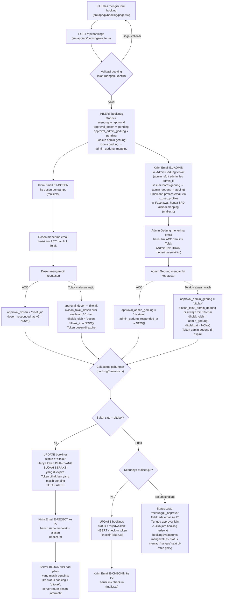
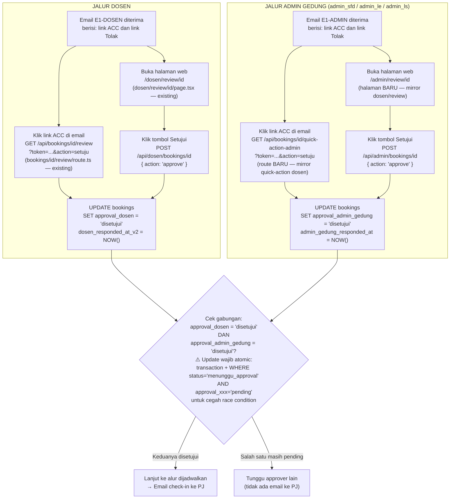
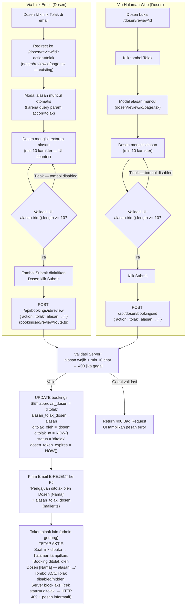
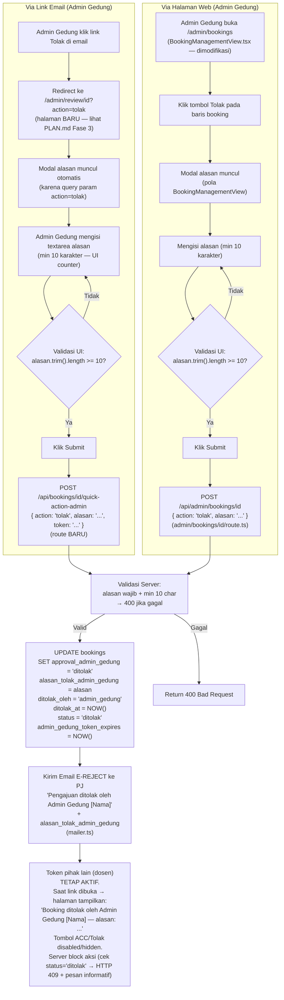
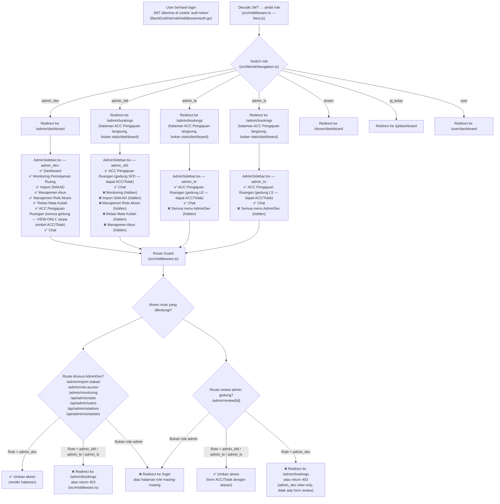
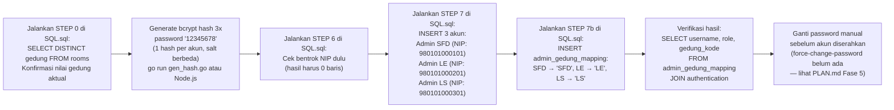
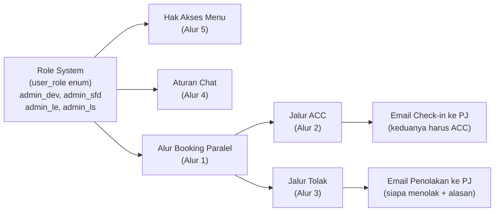
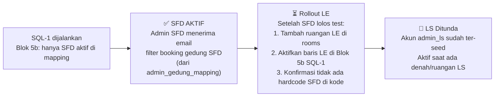

# FLOW.md — Diagram Alur Fitur Tambah Role Baru (SiRuang)

> **Status:** Dokumen perencanaan — read-only, belum diimplementasikan.
> **Referensi file asli:** lihat `PLAN.md` dan `PRD.md` di folder yang sama.
> **Terakhir diperbarui:** 2026-11-21 (revisi: fokus SFD dulu, 2 file SQL, rollout LE, LS ditunda)

---

## 1. Alur Booking Baru (Paralel Approval)

Alur lama: `PJ → Dosen → Admin (sequential)`.
Alur baru: `PJ → Dosen + Admin Gedung (paralel)` → gate keduanya → check-in.
**AdminDev tidak terlibat dalam alur approval sama sekali.**



---

## 2. Alur ACC — Sinkron Email & Web

Baik via email (token link) maupun via halaman web, keduanya menulis ke **kolom yang sama** di tabel `bookings` sehingga status selalu sinkron otomatis.



> [!NOTE]
> `approval_dosen` dan `approval_admin_gedung` adalah kolom di tabel `bookings` (rencana migrasi di `SQL.sql`).
> Karena keduanya menulis ke kolom yang sama, jalur email dan web selalu sinkron tanpa logika tambahan.

---

## 3. Alur Penolakan Wajib Alasan

**Ketentuan penting:**
- Alasan wajib min **10 karakter** untuk dosen maupun admin gedung (dikonfirmasi).
- Link Tolak di email **tidak langsung menolak** — selalu redirect ke halaman form alasan.
- Validasi di **dua lapis**: UI (tombol disabled) + Server (return 400).
- Hanya token **pihak yang sudah beraksi** yang di-expire. Token pihak yang belum klik tetap aktif, tapi server block aksi jika status booking sudah `ditolak`.

### 3.1 Penolakan oleh Dosen



### 3.2 Penolakan oleh Admin Gedung

Pola identik dengan dosen. Min alasan juga **10 karakter** (dikonfirmasi sama dengan dosen).



> [!IMPORTANT]
> **Dua lapis validasi wajib:** UI (tombol disabled) + Server (return 400).
> **Link Tolak di email tidak langsung menolak** — selalu redirect ke halaman form alasan.
> **Hanya token pihak yang sudah beraksi yang di-expire** — token pihak lain tetap aktif.
> Referensi pola existing: `src/app/api/bookings/id/review/route.ts` dan `src/app/dosen/review/id/page.tsx`.

---

## 4. Alur Chat Per Role

Berdasarkan analisis `BackEnd/internal/models/chat.go` dan `BackEnd/internal/handlers/chat.go`.

```mermaid
flowchart TD
    LOGIN["User Login\n→ role terdeteksi dari JWT\n(BackEnd/internal/middleware/auth.go)"]

    LOGIN --> R_USER["Role: user"]
    LOGIN --> R_DOSEN["Role: dosen"]
    LOGIN --> R_PJ["Role: pj_kelas"]
    LOGIN --> R_ADMIN["Role: admin_dev\nadmin_sfd / admin_le / admin_ls"]

    subgraph CHAT_USER["Chat — User Biasa"]
        U1["Buka sidebar chat (/user/chat)"]
        U2["Gunakan fitur Search\n(cari nama akun admin)\nEndpoint: GET /api/chat/search-admin?q=nama"]
        U3["Pilih admin dari hasil search\n(admin_dev, admin_sfd, admin_le, atau admin_ls)"]
        U4["Sistem cek: room sudah ada?\nquery chat_rooms:\nWHERE user_identifier = pemilik\nAND participant_b_identifier = admin_id\nAND room_type = 'user_to_admin'"]
        U5{"Room sudah ada?"}
        U6["Buka room yang sudah ada"]
        U7["INSERT chat_rooms baru\nroom_type = 'user_to_admin'\nparticipant_b_identifier = admin_id\nparticipant_b_role = 'admin_dev'/'admin_sfd'/'admin_le'/'admin_ls'"]
        U8["Mulai kirim pesan"]
    end

    subgraph CHAT_DOSEN["Chat — Dosen"]
        DOS1["Buka sidebar chat (/dosen/chat)"]
        DOS2["Tab: 'PJ Berelasi'\nauto-room dari relasi mata kuliah\nroom_type = 'pj_to_dosen'"]
        DOS3["Room PJ-Dosen dibuat otomatis\nsaat admin membuat relasi di\nRelasiMataKuliahView.tsx\n(atau di-backfill via SQL.sql STEP 8d)"]
        DOS4["Tab: 'Pesan Baru'\nSearch admin via nama\n(admin_dev, admin_sfd, admin_le, admin_ls)"]
        DOS5["Pilih admin → buka/buat room\nroom_type = 'user_to_admin'"]
    end

    subgraph CHAT_PJ["Chat — PJ Kelas"]
        PJ1["Buka sidebar chat (/pj/chat)"]
        PJ2["Tab: 'Dosen Saya'\nauto-room dari relasi mata kuliah\nroom_type = 'pj_to_dosen'"]
        PJ3["Tab: 'Chat Umum'\nchat biasa dengan sesama user\nroom_type = 'general'"]
        PJ4["Tab: 'Pesan Baru'\nSearch admin atau user lain"]
    end

    subgraph CHAT_ADMIN["Chat — Admin (semua tipe)"]
        ADM1["Buka sidebar chat (/admin/chat)"]
        ADM2["Lihat semua room yang melibatkan akun ini\nchat_rooms:\nWHERE participant_b_identifier = admin_identifier\nOR user_identifier = admin_identifier\n(admin_dev juga melihat room lama:\nparticipant_b_identifier IS NULL)"]
        ADM3["Balas pesan masuk\n(tidak ada batasan siapa yang dibalas)"]
    end

    R_USER --> CHAT_USER
    R_DOSEN --> CHAT_DOSEN
    R_PJ --> CHAT_PJ
    R_ADMIN --> CHAT_ADMIN

    U1 --> U2 --> U3 --> U4 --> U5
    U5 -->|"Ya"| U6 --> U8
    U5 -->|"Tidak"| U7 --> U8

    DOS1 --> DOS2 --> DOS3
    DOS1 --> DOS4 --> DOS5

    PJ1 --> PJ2
    PJ1 --> PJ3
    PJ1 --> PJ4

    ADM1 --> ADM2 --> ADM3
```



> [!NOTE]
> **Auto-room PJ-Dosen:** Dibuat saat relasi disimpan di `RelasiMataKuliahView.tsx`.
> **Backfill relasi existing:** SQL.sql STEP 8d membuat room PJ-dosen untuk semua relasi `official_schedules` yang sudah ada.
> **Room lama (menunjuk ke admin_dev):** Tetap valid — akun admin lama hanya di-rename role-nya, tidak dihapus.
> **Search admin:** Mengembalikan semua akun dengan role `admin_dev`, `admin_sfd`, `admin_le`, `admin_ls`.

---

## 5. Alur Hak Akses Menu (Sidebar & Route Guard)

Berdasarkan `src/lib/roleNavigation.ts`, `src/middleware.ts`, dan `src/components/Admin/Web&Tab/components/AdminSidebar.tsx`.



> [!IMPORTANT]
> **Tiga lapis perlindungan wajib diimplementasikan:**
> 1. **UI**: Menu disembunyikan di `AdminSidebar.tsx` berdasarkan role dari context/session.
> 2. **Route Guard**: `src/middleware.ts` cek role dari JWT sebelum render halaman.
> 3. **API Server**: Setiap endpoint `/api/admin/*` wajib verifikasi role + validasi gedung di server.
>
> Filter ACC Pengajuan untuk `admin_sfd`/`admin_le`/`admin_ls`: query booking di-filter
> berdasarkan `rooms.gedung` yang sesuai `admin_gedung_mapping` untuk admin login tersebut.

---

## 6. Alur Seeding Akun Admin Gedung



> **Cara generate hash bcrypt dari `12345678`:**
> ```bash
> # Node.js (jalankan 3x, hasilkan hash berbeda tiap run)
> node -e "const b=require('bcryptjs'); b.hash('12345678',10).then(h=>console.log(h))"
>
> # Go (via BackEnd project)
> cd BackEnd && go run gen_hash.go
> ```
> Hash asli **harus di-generate saat implementasi** — jangan pakai hash contoh/placeholder.

---

## Ringkasan Keterkaitan Alur



---

## Fase Rollout Gedung



> [!NOTE]
> Email admin gedung selalu diambil dari `profiles.email` via `v_user_profiles`.
> Tidak ada hardcode `'SFD'` di kode — gedung dibaca dari `admin_gedung_mapping` berdasarkan akun admin yang login.
> Status `dibatalkan`, `dibatalkan_prioritas`, `kedaluwarsa` = terminal; tidak di-evaluate ulang ke `hangus` oleh `bookingEvaluator.ts`.

---

*Dokumen ini adalah bagian dari paket perencanaan fitur Tambah Role Baru.*
*File terkait: `PLAN.md` | `PRD.md` | `SQL.sql`*
*Semua nama file, route, tabel, dan kolom mengacu pada struktur nyata project SiRuang hasil analisis.*
