# FLOW — Chat Room Per Role (Revisi 3)
**File:** `PlanArchive/ChatRoomPerRole/FLOW.md`
**Dibuat:** 2026-11-22 | **Diperbarui:** 2026-11-22
**Referensi:** PLAN.md (Revisi 3), SQL.sql (Revisi 3)

---

## Daftar Diagram
1. [Room Per Role — Kepemilikan](#diagram-1-room-per-role--kepemilikan)
2. [Auto-Create Room Saat Login/Mount](#diagram-2-auto-create-room-saat-loginmount)
3. [Alur Search Admin Gedung](#diagram-3-alur-search-admin-gedung)
4. [Alur AdminDev Search & Inisiasi](#diagram-4-alur-admindev-search--inisiasi)
5. [Alur Kirim Pesan dan Update Preview](#diagram-5-alur-kirim-pesan-dan-update-preview)
6. [Validasi Akses Admin Gedung](#diagram-6-validasi-akses-admin-gedung)
7. [Realtime Multi-Room (Subscription)](#diagram-7-realtime-multi-room--subscription)
8. [Masa Transisi Format `dosen:NIP:NIM`](#diagram-8-masa-transisi-format-dosenipnim)
9. [Alur Deduplication Room](#diagram-9-alur-deduplication-room)
10. [Bug Preview — Sebelum dan Sesudah Fix](#diagram-10-bug-preview--sebelum-dan-sesudah-fix)
11. [Fungsi Atomik get_or_create_room](#diagram-11-fungsi-atomik-get_or_create_room)
12. [Label Matkul Gabungan per Pasangan PJ-Dosen](#diagram-12-label-matkul-gabungan-per-pasangan-pj-dosen)

---

## Diagram 1: Room Per Role — Kepemilikan

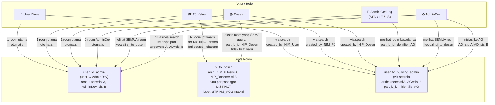

---

## Diagram 2: Auto-Create Room Saat Login/Mount

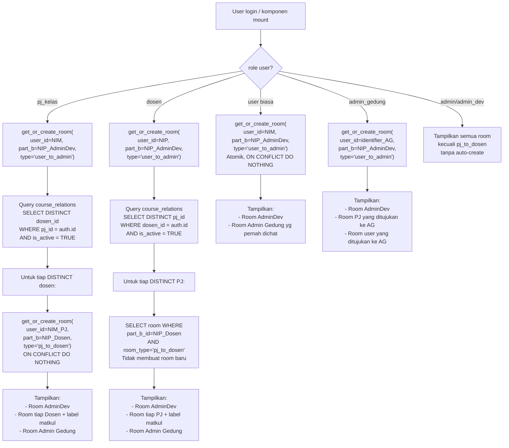

> **Penting:** Semua create room menggunakan fungsi `get_or_create_room` (SQL Blok 7e) yang atomik — `INSERT ... ON CONFLICT DO NOTHING`. Hook frontend wajib punya guard `hasCreated.current` agar tidak memanggil create lebih dari sekali per sesi.

---

## Diagram 3: Alur Search Admin Gedung

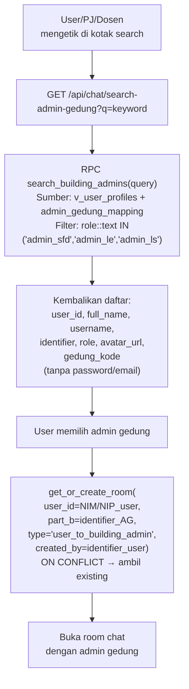

> **Kata kunci yang berfungsi:** "LS", "LE", "SFD", "admin gedung", nama lengkap, username. Cocokkan via `gedung_kode` dari `admin_gedung_mapping`, bukan hardcode. `participant_b_identifier` = `authentication.identifier`, bukan `username`.

---

## Diagram 4: Alur AdminDev Search & Inisiasi

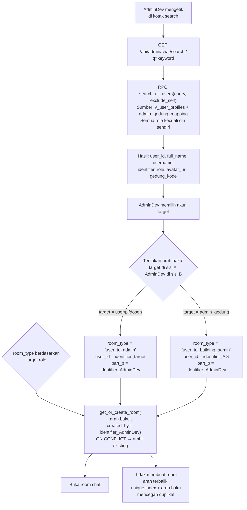

> **Kunci:** AdminDev selalu di sisi B (`participant_b_identifier`). Target di sisi A (`user_identifier`). `ON CONFLICT` pada `uq_rooms_pair` mencegah duplikat jika room sudah ada dari inisiasi target.

---

## Diagram 5: Alur Kirim Pesan dan Update Preview

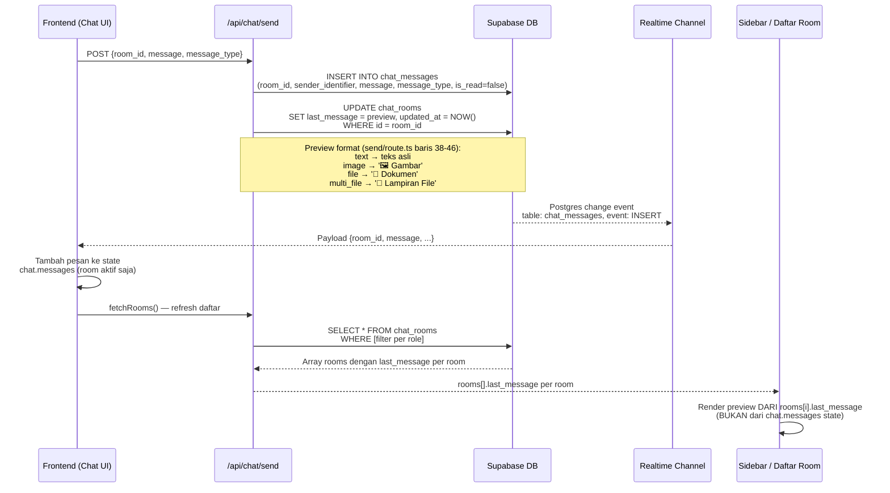

> **Kunci perbaikan Bug B:** Sidebar membaca `rooms[i].last_message` dari array rooms (dari API), **bukan** dari `chat.messages` state hook yang hanya berisi pesan room aktif.

---

## Diagram 6: Validasi Akses Admin Gedung

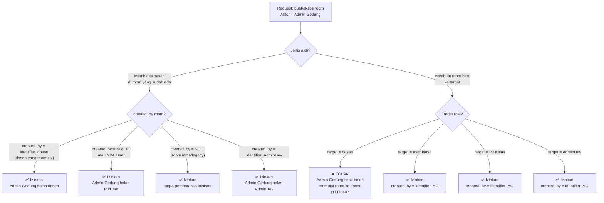

---

## Diagram 7: Realtime Multi-Room (Subscription)

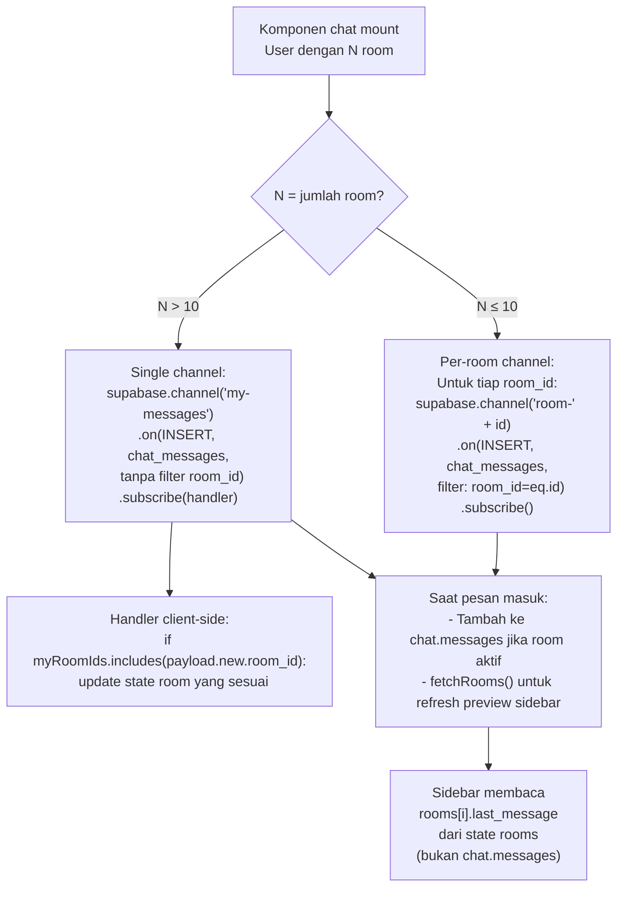

> **Batas praktis Supabase Realtime:** ~20 channel per klien. Dosen dengan 30+ PJ → wajib single-channel.

---

## Diagram 8: Masa Transisi Format `dosen:NIP:NIM`

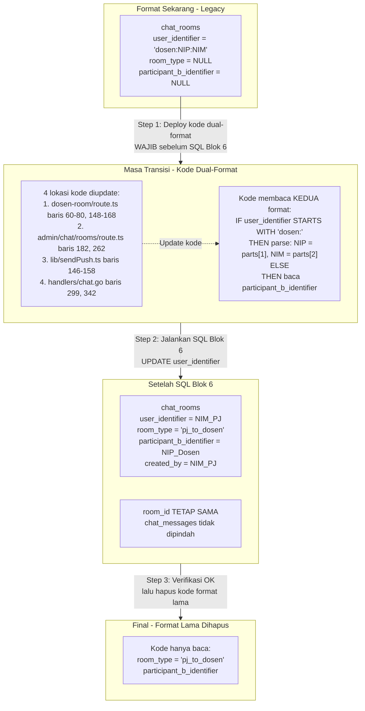

---

## Diagram 9: Alur Deduplication Room

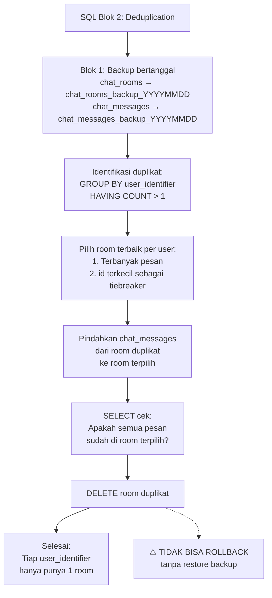

---

## Diagram 10: Bug Preview — Sebelum dan Sesudah Fix

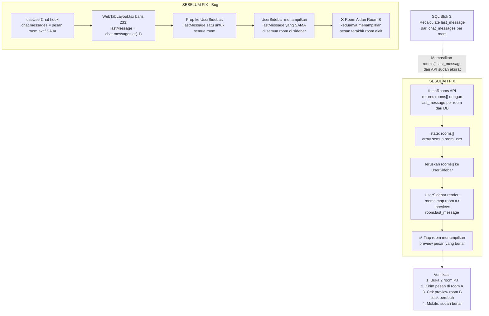

---

## Diagram 11: Fungsi Atomik get_or_create_room

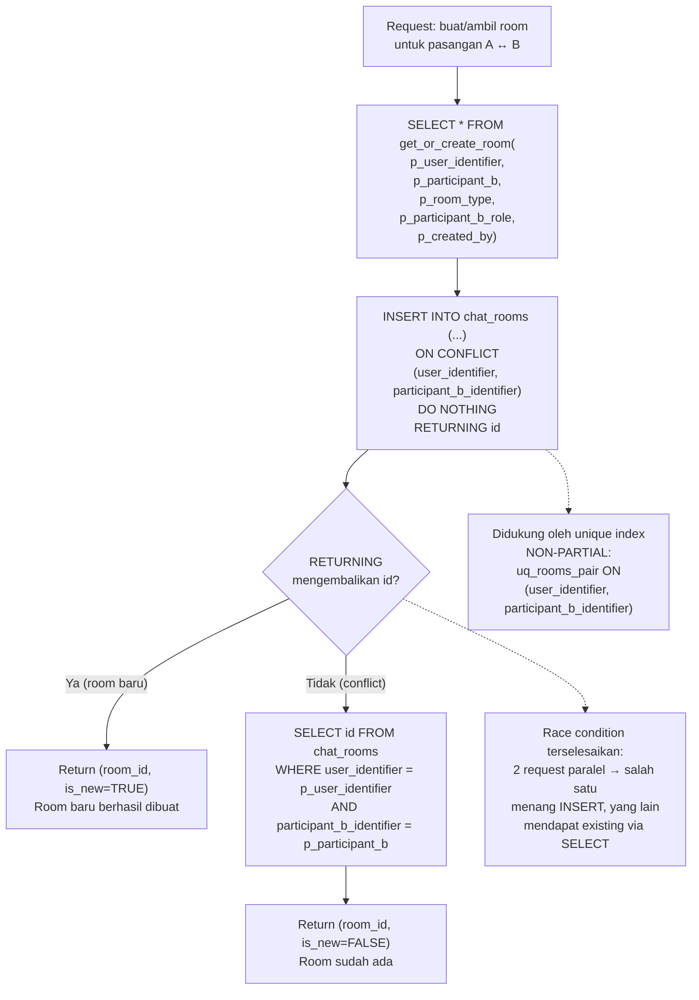

> **Mencegah duplikat dari semua jalur:** Go `GetOrCreateRoom`, Next.js `user-room`, `dosen-room`, `admin/chat/rooms`, PJ mount ganda, AdminDev inisiasi — semua memanggil fungsi ini.

---

## Diagram 12: Label Matkul Gabungan per Pasangan PJ-Dosen

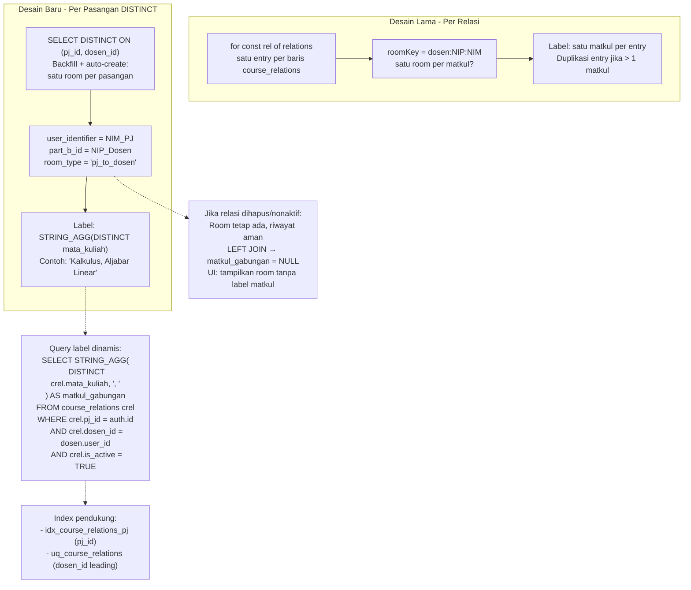

---

## Ringkasan Perubahan Per File

| File | Kondisi Sebelum | Kondisi Sesudah |
|------|----------------|----------------|
| `chat_rooms` (DB) | 6 kolom, format `dosen:NIP:NIM`, tidak ada constraint unik | +4 kolom baru, CHECK, unique index NON-partial, fungsi atomik |
| `chat_messages` (DB) | kolom `sender_identifier`, `is_read` | Tidak berubah (skema sudah benar) |
| `course_relations` (DB) | Index hanya `uq_course_relations` + PK | + `idx_course_relations_pj` (Blok 1b, SEKARANG) |
| `chat.go` | SELECT+INSERT tanpa upsert | Panggil `get_or_create_room` SQL function |
| `user-room/route.ts` | maybeSingle + insert | RPC `get_or_create_room` |
| `dosen-room/route.ts` | double insert bug + per-relasi + format lama | Fix: DISTINCT pasangan, hapus double-insert, `STRING_AGG` label |
| `admin/chat/rooms/route.ts` | filter `LIKE 'dosen:%'` | filter `room_type != 'pj_to_dosen'`; AdminDev search + inisiasi |
| `WebTabLayout.tsx` | `lastMessage` dari `chat.messages` (satu, shared) | `room.last_message` per room dari API |
| `MobileChatListView.tsx` | `room.last_message` per room — sudah benar | Tidak berubah (mobile sudah benar) |
| `sendPush.ts` | `startsWith('dosen:')` saja | dual-format support |
| `search-admin-gedung` (BARU) | — | RPC `search_building_admins` via `v_user_profiles` + `admin_gedung_mapping` |
| `admin/chat/search` (BARU) | — | RPC `search_all_users` (AdminDev, semua akun) |
