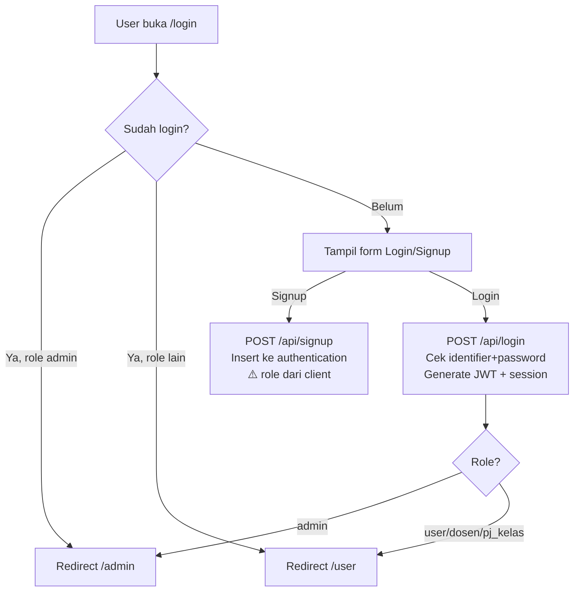
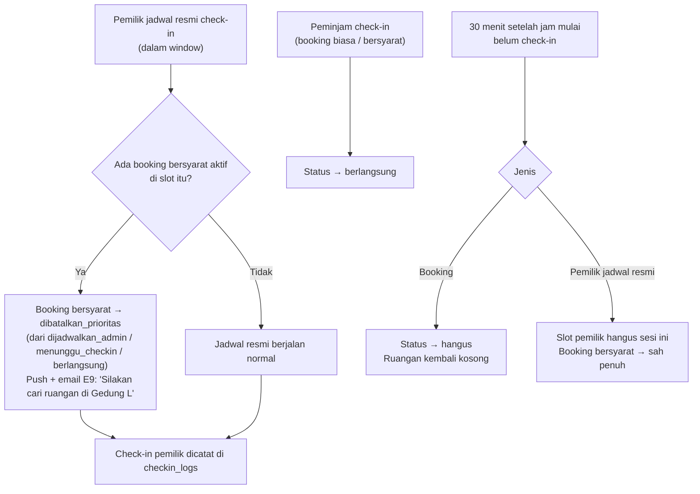
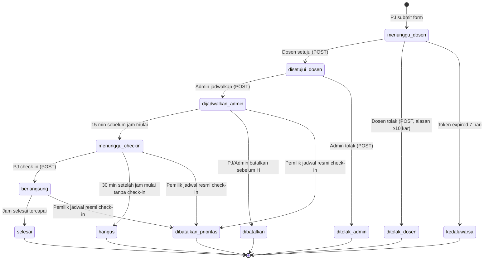
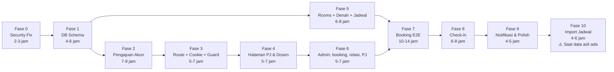

# 📋 PlanCoore v4 — Rencana Pengembangan Fitur SiRuang (REVISI FINAL, VERSI LENGKAP)

> **Tanggal:** 15 November 2026
> **Status:** 🟢 **SELESAI 100% (Seluruh Fase 0 s/d Fase 10 SELESAI TUNTAS)** — Seluruh fitur inti peminjaman ruangan Gedung SFD, persetujuan dosen langsung terjadwal, monitoring admin read-only, denah interaktif real-time SVG, check-in perkuliahan, notifikasi push & email lengkap (E1–E10), badges sidebar, ekspor Excel, serta **Fase 10: Import Jadwal Resmi SIAKAD (Excel/CSV), Denah Biru `#3B82F6`, Booking Bersyarat, dan Sistem Prioritas Otomatis** telah tuntas dan teruji 100%.
> **Scope:** Fokus Gedung SFD saja. Gedung L dan lainnya TIDAK disentuh.
> **Revisi:** PlanCoore v1 → v2 → v3 → v4 (dokumen ini, satu-satunya file rencana)

---

## 0. Daftar Perubahan

### Dari v1 → v2
| # | Perubahan | Alasan |
|---|---|---|
| Δ1 | **Fitur baru: Pendaftaran butuh persetujuan admin** — Tabel `registration_requests` menggantikan direct-insert ke `authentication` + `profiles.status = 'pending_verification'` | Instruksi user bagian B |
| Δ2 | **Email di form signup mahasiswa sekarang WAJIB** | Instruksi user B.8 |
| Δ3 | **Tipe FK ke `authentication.id` dikoreksi menjadi `int4`** (bukan uuid). PK tabel baru tetap uuid. | Koreksi teknis E.1 |
| Δ4 | **FK kondisional `WHERE role = ...` dihapus**, diganti validasi di API server | Koreksi teknis E.2 |
| Δ5 | **Link email dosen/admin: GET = tampilkan halaman, aksi = POST** | Koreksi teknis E.3 |
| Δ6 | **RLS dinyalakan per tabel, bukan sekaligus**; `chat_messages` butuh SELECT policy untuk Realtime | Koreksi teknis E.4 + temuan kode |
| Δ7 | **JWT_SECRET fallback hardcoded ditambahkan ke Fase 0** | Koreksi teknis E.5 |
| Δ8 | **Booking: ditambah kolom SKS, jam selesai auto-hitung, exclusion constraint** | Instruksi user D |
| Δ9 | **Denah: hanya date picker (tanpa slider jam), warna per tanggal, klik tampilkan slot** | Instruksi user D |
| Δ10 | **Denah: ruangan non-bookable TIDAK ada tooltip/hover/cursor pointer** | Instruksi user C |
| Δ11 | **Meeting Room dipecah SVG** dengan garis pemisah vertikal → R.302 (kiri) dan R.303 (kanan) | Jawaban Q6+Q7 |
| Δ12 | **Lantai 8: R.801 non-bookable**, hanya R.802 dan R.805 | Jawaban Q2 |
| Δ13 | **PJ Kelas: hanya lewat promosi admin**, tidak bisa daftar sendiri | Jawaban Q3 |
| Δ14 | **Dosen: TIDAK punya form booking**, hanya approve/reject + riwayat | Jawaban Q4 |
| Δ15 | **Alasan penolakan dosen: WAJIB minimal 10 karakter** | Jawaban Q5 |
| Δ16 | **Email provider: Nodemailer + Gmail SMTP** (bukan Resend) | Jawaban Q8 |
| Δ17 | Fase direnomori ulang, fase "Pengajuan Akun" ditambahkan, estimasi diperbarui | Umum |

### Dari v2 → v3
| # | Perubahan | Alasan |
|---|---|---|
| Δ18 | **Tabel `official_schedules` + data DUMMY** — jadwal resmi SIAKAD disimulasikan dulu, kolom `is_dummy` untuk penanda | Keputusan 1.1 |
| Δ19 | **Import Excel/CSV jadwal resmi oleh admin** — dirancang, ditaruh di fase belakangan | Keputusan 1.1 |
| Δ20 | **Pemindahan ruangan DIHAPUS** — tidak ada pencarian/penggantian ruangan otomatis. Jika pemilik check-in saat peminjam di ruangan → booking dibatalkan + saran cari ruangan kosong di Gedung L (teks saja) | Keputusan 1.2 |
| Δ21 | **Status `dipindahkan` DIHAPUS**, diganti `dibatalkan_prioritas` | Keputusan 1.2 |
| Δ22 | **Sistem check-in** — tombol di halaman PJ, aturan waktu (15 min sebelum / 30 min setelah), prioritas pemilik jadwal, status `menunggu_checkin` + `berlangsung` + `hangus` | Keputusan 1.3 |
| Δ23 | **QR check-in** dicatat sebagai pengembangan nanti, tanpa rancangan detail | Keputusan 1.3 |
| Δ24 | **Email: Nodemailer + Gmail SMTP final** — template email, env vars, risiko + mitigasi | Keputusan 1.4 |
| Δ25 | **Tabel `checkin_logs`** — log check-in | Keputusan 1.3 |
| Δ26 | **Tabel `email_logs`** — log email terkirim/gagal | Keputusan 1.4 |
| Δ27 | **Booking bersyarat** — booking pada slot yang ada jadwal resmi, berlaku jika pemilik tidak check-in | Keputusan 1.1+1.2+1.3 |
| Δ28 | **State machine diperbarui** — transisi lengkap dengan aktor | Sinkronisasi |
| Δ29 | **Legenda denah diperbarui** — penanda jadwal resmi | Sinkronisasi |
| Δ30 | **Fase diperbarui** — fase check-in + import jadwal ditambahkan, estimasi baru | Sinkronisasi |

### Dari v3 → v4 (REVISI INI)
| # | Perubahan | Alasan |
|---|---|---|
| Δ31 | **Pengajuan akun ditolak / kedaluwarsa = baris DIHAPUS.** Status `rejected` / `expired` dan kolom `status` dibuang dari `registration_requests`. Jejak cukup di `email_logs` | Hash password orang yang ditolak tidak boleh tersimpan |
| Δ32 | **Approve akun lewat fungsi Postgres (RPC)** dalam satu transaksi | supabase-js biasa tidak bisa transaksi multi-tabel |
| Δ33 | **Fase 0 memeriksa view `users` dan `v_user_profiles`** (security_invoker / cabut akses anon) | View bisa membocorkan data walau RLS tabel aktif |
| Δ34 | **Fase 3: login/logout menyimpan token di cookie httpOnly** agar middleware berfungsi | Middleware tidak bisa membaca localStorage |
| Δ35 | **Setup Nodemailer = langkah pertama Fase 2** | Sebelumnya tidak ada di fase manapun |
| Δ36 | **Dosen harus dipilih dari daftar dosen terdaftar.** Fallback ketik manual hanya untuk mata kuliah | Tanpa akun tidak ada email tujuan |
| Δ37 | **Urutan fase diperbaiki:** fitur admin (booking, relasi, promosi PJ) jadi **Fase 6**; Booking E2E jadi **Fase 7** | Booking E2E butuh admin untuk menjadwalkan dan relasi dosen–PJ |
| Δ38 | **Exclusion constraint berlaku untuk SEMUA booking aktif, termasuk bersyarat** | Dua peminjam bersyarat tidak boleh lolos berdua |
| Δ39 | **Akun demo yang sudah ada dipakai:** PJ Kelas Demo (id 4, NIM 1313620099), Dosen Demo (id 3, NIP 197805152005011002) | Tidak dibuat saat seed |
| Δ40 | **Jumlah status booking dikoreksi: 12** | Sebelumnya tertulis 11 |
| Δ41 | **`dibatalkan_prioritas` bisa dari `dijadwalkan_admin`, `menunggu_checkin`, `berlangsung`** | Pemilik bisa check-in kapan saja dalam window-nya |
| Δ42 | **Pseudocode lazy-check memakai tanggal + jam, zona Asia/Jakarta** | Sebelumnya jam saja (sumber bug umum) |
| Δ43 | **Estimasi total dihitung ulang: ~54–74 jam** | Setelah perubahan fase |
| Δ44 | **Penanda "bersyarat"** di daftar pengajuan admin (6.1) dan dosen (4.8) | Perlu terlihat saat memutuskan |
| Δ45 | **Catatan warna denah (merah seharian).** Penanda "sebagian terpakai" **DITUNDA** (pengembangan nanti) | Keputusan pemilik (Q13) |
| Δ46 | **Strategi halaman PJ & Dosen = copy dari User**, ubah route + sedikit tambahan (bagian 7) | Permintaan pemilik |
| Δ47 | **Mahasiswa biasa read-only** (denah/chat/profil saja); form booking hanya di halaman PJ | **Dikonfirmasi pemilik** (Q14) |

---

## 1. Ringkasan Pemahaman Sistem Saat Ini

### 1.1 Arsitektur Umum
- **Frontend:** Next.js 16 (App Router), React 19, Tailwind CSS 4, Framer Motion, Lucide Icons
- **Backend:** Go backend (terpisah, folder `BackEnd/`) + Next.js API Routes (folder `FrontEnd/src/app/api/`)
- **Database:** Supabase (PostgreSQL)
- **Autentikasi:** Custom JWT (bukan Supabase Auth), bcrypt untuk password, session management via tabel `active_sessions`. Token saat ini disimpan di localStorage
- **Push Notification:** Web Push via `web-push` package, sudah berjalan
- **Email:** ❌ BELUM ADA — akan pakai Nodemailer + Gmail SMTP
- **Machine Learning:** Backend Python (`MachineLearning/`) untuk auto-reply AI di chat admin

### 1.2 Tabel Database yang Diketahui (dari kode dan screenshot Supabase)

| Tabel | Kolom yang terlihat |
|---|---|
| `authentication` | `id` (int4 PK), `username`, `identifier`, `identifier_type` ('nim'/'nip'), `password` (bcrypt hash), `role` (enum: admin/user/dosen/pj_kelas), `created_at` |
| `profiles` | `user_id` (int4, FK → authentication.id), `full_name`, `email`, `phone`, `whatsapp`, `faculty`, `avatar_url`, `is_default_avatar`, `updated_at` |
| `active_sessions` | `id`, `identifier`, `session_id` (JWT token), `last_activity` |
| `captcha` | (dipakai untuk captcha math di login) |
| `chat_rooms` | (live chat user ↔ admin) |
| `chat_messages` | (pesan dalam chat room) |
| `push_subscriptions` | (endpoint push notification per device) |
| `v_user_profiles` (VIEW) | JOIN `authentication` + `profiles` |
| `users` (VIEW) | **Isi belum diperiksa** — wajib dicek di Fase 0 (apakah memuat kolom password) |

**Akun demo yang sudah ada di `authentication`:** Admin SiRuang (id 1, NIP 198501012010121001), Mahasiswa (id 2, NIM 1313620001), **Dosen Demo (id 3, NIP 197805152005011002)**, **PJ Kelas Demo (id 4, NIM 1313620099)**, Syafikh_AL (id 6, NIM 1512625004).

> [!NOTE]
> **`authentication.id` bertipe `int4`** (terlihat di screenshot Supabase: 1, 2, 3, 4, 6). Semua FK ke tabel ini harus `int4`. Tipe `profiles.user_id` dikonfirmasi dari skema Supabase saat Fase 1 (bukan ditebak).

### 1.3 File & Folder Kunci

```
FrontEnd/src/
├── app/
│   ├── admin/page.tsx          ← Halaman admin (cek role admin via localStorage)
│   ├── user/page.tsx           ← Halaman user/mahasiswa (semua non-admin masuk sini)
│   ├── login/page.tsx          ← Halaman login + signup
│   ├── denah-sfd/              ← Route denah gedung SFD (lantai3, lantai8)
│   ├── api/signup/route.ts     ← API registrasi (⚠️ role dari client)
│   ├── api/login/route.ts      ← API login + JWT + session
│   ├── api/logout/route.ts     ← API logout
│   ├── api/profile/route.ts    ← GET & PUT profil user
│   └── api/push/               ← Subscribe/unsubscribe push notification
├── components/
│   ├── Authentication/         ← Form login & signup (Web, Mobile)
│   ├── Admin/                  ← Dashboard admin (Web, Mobile, Shared)
│   ├── User/                   ← Dashboard mahasiswa (Web, Mobile, Shared)
│   ├── Dosen/                  ← 📋 COPY dari User, struktur identik
│   ├── PJKelas/                ← 📋 COPY dari User, struktur identik
│   ├── Profile/                ← Komponen profil per role (Admin, Dosen, PJ, User)
│   ├── DenahVisual/DenahGedungSFD/  ← Denah visual SVG lantai 3 & 8
│   └── Shared/                 ← Komponen bersama (Avatar, Alert, Logo, dll)
├── lib/
│   ├── authHelper.ts           ← generateToken, verifyToken, getUserFromRequest
│   ├── roleNavigation.ts       ← getRoleDashboardPath (admin→/admin, lainnya→/user)
│   ├── supabaseServer.ts       ← Supabase client (service role)
│   └── supabaseClient.ts       ← Supabase client (anon key, untuk Realtime)
└── hooks/                      ← usePushNotifications, useIsMobile, dll
```

### 1.4 Alur Auth Saat Ini



> [!CAUTION]
> **Bug keamanan kritis:** Role dikirim dari CLIENT. User bisa memanipulasi request body dan mendaftar sebagai `admin`. Fix di Fase 0.

### 1.5 Denah SFD — Kondisi Saat Ini

**Lantai 8:**
- BOOKABLE_ROOMS di kode: `R.801`, `R.802`, `R.805` ← **R.801 harus dihapus**
- Yang benar bookable: hanya **R.802** (Lab Multimedia) dan **R.805** (Lab Komputer)
- Data jadwal: HARDCODED dummy di `Jadwal.tsx`

**Lantai 3:**
- BOOKABLE_ROOMS di kode: `R-01` s/d `R-07` (7 ruangan) ← **Harus diubah jadi hanya R.303**
- Meeting Room saat ini = satu ruangan (`R-02`, rect x=365, y=160, w=335, h=202) ← **Dipecah jadi R.302 + R.303**
- Internal rect meja rapat: x=537, y=285, w=103, h=77
- Data jadwal: HARDCODED dummy di `Jadwal.tsx`

### 1.6 Halaman Dosen & PJ Kelas — Kondisi Saat Ini
- Folder `components/Dosen/` dan `components/PJKelas/` **sudah ada** (copy dari `User/`)
- Isinya identik dengan User
- **Belum ada route** `/dosen` atau `/pj` di `src/app/`
- **Belum ada `middleware.ts`** di `src/`
- `roleNavigation.ts` mengarahkan semua non-admin ke `/user`
- Strategi lengkap penyesuaian copy ada di **bagian 7**

### 1.7 Relasi Dosen ↔ PJ Kelas — Kondisi Saat Ini
- Komponen `RelasiMataKuliahView.tsx`: **100% DUMMY DATA** (hardcoded array)
- **Belum ada tabel database** dan **belum ada API route**
- Tombol "Tambah Relasi", "Chat PJ", "Ubah" belum fungsional
- `RoleAccessView.tsx`: juga dummy

### 1.8 Variabel Environment (.env.local)
Variabel yang ada (NAMA saja, nilai TIDAK ditampilkan):
`NEXT_PUBLIC_API_URL`, `NEXT_PUBLIC_SUPABASE_URL`, `NEXT_PUBLIC_SUPABASE_ANON_KEY`, `SUPABASE_SERVICE_ROLE_KEY`, `JWT_SECRET`, `ML_SERVICE_URL`, `NEXT_PUBLIC_VAPID_PUBLIC_KEY`, `VAPID_PRIVATE_KEY`, `VAPID_SUBJECT`

> [!WARNING]
> `JWT_SECRET` di `authHelper.ts` baris 4 memiliki **hardcoded fallback**: jika env var tidak di-set, secret hardcoded dipakai. TIDAK AMAN untuk production.

---

## 2. Penjelasan Sistem Relasi Dosen–PJ Kelas

### 2.1 Apa yang Sudah Ada
Di halaman admin ada tabel "Relasi Mata Kuliah" yang menampilkan hubungan Dosen ↔ PJ Kelas ↔ Mata Kuliah. **Tapi ini semua masih data contoh hardcoded.** Belum ada tabel database, belum ada API.

### 2.2 Fungsi Relasi
Relasi menjawab: "PJ kelas X mengikuti mata kuliah Y yang diampu dosen Z". Dipakai untuk:
1. Mengisi otomatis dosen + mata kuliah di form booking
2. Menentukan **pemilik jadwal resmi** (PJ di relasi = yang check-in)
3. Memastikan email persetujuan terkirim ke dosen yang tepat

### 2.3 Desain yang Dipilih: Relasi Dibuat Admin
Admin membuat relasi terlebih dahulu:
> "PJ Kelas Anita (NIM 240509xxx) → Dosen Dr. Rahmawati → Mata Kuliah Pemrograman Web → Kelas PTIK-3A"

Saat PJ login dan buka form booking:
- **Dosen pengampu:** dropdown, hanya dosen yang **punya akun terdaftar** (dari relasi PJ tsb, atau daftar semua dosen terdaftar). **TIDAK ada ketik manual**, karena tanpa akun tidak ada alamat email untuk mengirim link persetujuan.
- **Mata kuliah:** otomatis dari relasi. Jika relasi belum diatur, PJ boleh ketik manual (dengan catatan "belum diverifikasi"). Fallback manual **hanya** untuk mata kuliah.

### 2.4 Penanganan Kasus Khusus

| Kasus | Solusi |
|---|---|
| Dosen belum punya akun | Tidak bisa dipilih di form maupun dijadikan relasi. Form menampilkan: "Dosen belum terdaftar. Minta dosen mendaftar dulu." |
| Satu dosen banyak kelas | Satu `dosen_id` di banyak baris `course_relations` |
| Satu PJ banyak dosen | Satu `pj_id` di banyak baris |
| Pergantian semester | Field `semester` + `is_active`. Awal semester: nonaktifkan lama, buat baru |

---

## 3. Konsep Jadwal Resmi & Booking Bersyarat

### 3.1 Jadwal Resmi (Official Schedules)
Jadwal resmi adalah jadwal kuliah yang sudah ditetapkan akademik (biasanya dari SIAKAD). Pemilik jadwal resmi = PJ Kelas yang terdaftar di relasi. Tidak ada integrasi langsung ke SIAKAD; datanya diimpor admin per semester.

**Saat ini:** Data jadwal resmi belum tersedia dari SIAKAD. Digunakan **data DUMMY** dengan penanda `is_dummy = true` agar mudah dihapus sekaligus dan diganti data asli nanti.

**Data dummy yang akan di-seed:**
- Ruangan: R.802, R.805, R.303
- Hari: beberapa slot Senin–Jumat
- Sebagian jam terisi, sebagian kosong
- PJ pemilik: akun **"PJ Kelas Demo" (id 4) yang sudah ada**; dosen: **"Dosen Demo" (id 3) yang sudah ada**

**Import data asli (fase belakangan):**
- Admin upload file Excel/CSV berformat: Kode Ruangan, Hari, Jam Mulai, Jam Selesai, Mata Kuliah, Dosen (NIP), PJ Kelas (NIM), Semester
- Validasi: cek kode ruangan ada di tabel `rooms`, cek NIP/NIM terdaftar, cek bentrok jadwal
- Halaman admin: tab "Import Jadwal" di menu Kelola Ruangan
- **Ditandai: dikerjakan saat data asli sudah tersedia**

### 3.2 Booking Bersyarat
Jika seorang PJ Kelas (bukan pemilik jadwal) ingin booking ruangan pada slot yang **sudah ada jadwal resmi**, booking tersebut bersifat **bersyarat**:
- Peminjam wajib mencentang persetujuan bahwa booking bisa dibatalkan
- Booking tetap diproses normal (dosen approve → admin approve)
- Status akhir admin = `dijadwalkan_admin` dengan flag `is_conditional = true`
- Artinya: booking ini SAH selama pemilik jadwal resmi **tidak check-in**
- Jika pemilik jadwal check-in → booking bersyarat otomatis dibatalkan (lihat 3.3)

### 3.3 Prioritas & Pembatalan
- **Pemilik jadwal resmi selalu menang.** Jika pemilik check-in saat slot sedang dipakai / dipesan peminjam bersyarat:
  - Status booking peminjam → `dibatalkan_prioritas`
  - Peminjam menerima **push notification + email** berisi:
    > "Booking Anda untuk R.802 pada [tanggal] [jam] telah dibatalkan karena pemilik jadwal resmi telah check-in. Silakan cari ruangan kosong di Gedung L atau ruangan lain yang tersedia."
  - Cukup teks saran, **tanpa data/denah/booking Gedung L** (Gedung L tetap tidak disentuh)
- **Tidak ada sistem pemindahan ruangan otomatis.** Peminjam harus mencari sendiri.

---

## 4. Sistem Check-in

### 4.1 Implementasi Tahap Sekarang
Tombol "Check-in" di halaman PJ Kelas. PJ menekan tombol saat tiba di ruangan.

> [!NOTE]
> **QR Code di ruangan** (scan QR untuk check-in) adalah **pengembangan di masa depan**. Saat ini cukup tombol manual. Implementasi QR memerlukan: generate QR unik per ruangan, cetak & pasang fisik, scanner di app mobile/web, token dinamis bertanda waktu (agar tidak bisa check-in dari rumah), dan validasi lokasi. Ini di luar scope fase saat ini.

### 4.2 Aturan Waktu Check-in

**Pemilik jadwal resmi:**
| Parameter | Nilai |
|---|---|
| Check-in dibuka | 15 menit SEBELUM jam mulai |
| Check-in ditutup | 30 menit SETELAH jam mulai |
| Jika tidak check-in | Slot hangus untuk SESI ITU — booking bersyarat (jika ada) menjadi sah penuh |

**Booking biasa (sudah di-ACC admin, bukan bersyarat):**
| Parameter | Nilai |
|---|---|
| Check-in dibuka | 15 menit SEBELUM jam mulai |
| Check-in ditutup | 30 menit SETELAH jam mulai |
| Jika tidak check-in | Status → `hangus`, ruangan kembali kosong (putih di denah) |

**Booking bersyarat:**
| Parameter | Nilai |
|---|---|
| Check-in dibuka | 15 menit SEBELUM jam mulai |
| Check-in ditutup | 30 menit SETELAH jam mulai |
| Jika pemilik jadwal check-in (saat status booking `dijadwalkan_admin`, `menunggu_checkin`, atau `berlangsung`) | Pemilik menang. Booking peminjam → `dibatalkan_prioritas` |
| Jika pemilik TIDAK check-in dalam window-nya | Booking bersyarat → sah penuh (flag `is_conditional` di-clear) |

> [!IMPORTANT]
> Semua waktu menggunakan zona **WIB (Asia/Jakarta)**. Server yang menghitung dan memvalidasi — bukan client. Check-in divalidasi berdasarkan jam server.

### 4.3 Otomatisasi: Lazy-check vs Scheduler

**Rekomendasi: Lazy-check (evaluasi saat data dibaca) + cron ringan sebagai jaring pengaman**

| Pendekatan | Pro | Kontra |
|---|---|---|
| **Lazy-check** ★ | Tidak perlu proses background, simpel, presisi tinggi (dievaluasi saat query), tidak bergantung uptime scheduler | Status di DB tidak langsung berubah (berubah saat di-query), notifikasi bisa terlambat |
| Scheduler (cron) | Status di DB selalu up-to-date, notifikasi tepat waktu | Perlu setup cron, risiko gagal jika server mati, tambah kompleksitas |

**Implementasi lazy-check (tanggal + jam digabung, zona Asia/Jakarta):**
```
// Pseudocode di API saat GET bookings / check-in
const TZ = 'Asia/Jakarta';

function evaluateBookingStatus(booking) {
  // WAJIB gabungkan tanggal + jam. Jangan pakai jam saja.
  const start = dayjs.tz(`${booking.tanggal} ${booking.jam_mulai}`, TZ);
  const end   = dayjs.tz(`${booking.tanggal} ${booking.jam_selesai}`, TZ);
  const now   = dayjs().tz(TZ);               // jam SERVER, bukan client
  const checkinOpen  = start.subtract(15, 'minute');
  const checkinClose = start.add(30, 'minute');

  if (booking.status === 'dijadwalkan_admin' && now >= checkinOpen) {
    await updateStatus(booking.id, 'menunggu_checkin', /*dari*/ 'dijadwalkan_admin');
  }
  if (booking.status === 'menunggu_checkin' && now > checkinClose) {
    await updateStatus(booking.id, 'hangus', 'menunggu_checkin');
    await sendNotification(booking.pemohon_id, 'Booking Anda hangus karena tidak check-in');
  }
  if (booking.status === 'berlangsung' && now >= end) {
    await updateStatus(booking.id, 'selesai', 'berlangsung');
  }

  // Jadwal resmi: pemilik tidak check-in sampai batas → booking bersyarat sah penuh
  if (booking.is_conditional && !ownerCheckedIn(booking.official_schedule_id, booking.tanggal)
      && now > checkinClose) {
    await clearConditionalFlag(booking.id);
  }
}
```
**Catatan:**
- Kolom `time` di Postgres tidak punya zona; seluruh perbandingan dilakukan di server dengan zona Asia/Jakarta.
- Setiap update status memakai kondisi `WHERE status = <status lama>` agar aman dari balapan (dua proses mengevaluasi bersamaan).
- Untuk kasus tidak ada yang membuka halaman (tidak ada query yang memicu lazy-check), tambahkan satu cron sederhana tiap 5 menit sebagai **safety net**, bukan mekanisme utama.

### 4.4 Alur Check-in (Diagram)



---

## 5. Layanan Email — Nodemailer + Gmail SMTP

### 5.1 Keputusan
**Nodemailer + Gmail SMTP** dipilih karena:
- Tidak punya domain, sehingga Resend tidak cocok (tanpa domain terverifikasi hanya bisa kirim ke pemilik akun)
- Bisa kirim ke email manapun termasuk dosen@unj.ac.id
- Gratis (batas ~500 email/hari dari Gmail, cukup untuk skala kampus)
- Setup cukup mudah: akun Gmail + App Password

### 5.2 Kebutuhan Setup (dikerjakan di Fase 2, langkah pertama)
1. **Akun Gmail khusus aplikasi** (misal: siruang.app@gmail.com) — JANGAN pakai email pribadi
2. **Verifikasi 2 langkah (2FA)** aktif di akun Gmail tersebut
3. **App Password** di-generate dari Google Account → Security → App Passwords
4. Kredensial disimpan di `.env.local`. **Hanya nama variabel yang boleh ditulis di dokumen; nilai diisi manual:**
   ```
   SMTP_HOST=smtp.gmail.com
   SMTP_PORT=587
   SMTP_USER=      ← alamat Gmail
   SMTP_PASS=      ← App Password (BUKAN password Gmail)
   SMTP_FROM_NAME=SiRuang
   ADMIN_EMAIL=    ← email admin yang menerima notifikasi
   ```
   > **PERINGATAN:** Nilai variabel di atas TIDAK boleh ditulis di dokumen/kode manapun. Hanya diisi langsung di file `.env.local`.

### 5.3 Konfigurasi Pengirim
- **Display name (from):** `SiRuang <alamat-gmail-aplikasi>`
- **Semua subjek email diawali:** `[SiRuang]`
- Karena tanpa domain, alamat pengirim tetap alamat Gmail. Beri tahu dosen agar cek folder spam di awal.

### 5.4 Template Email

| # | Template | Penerima | Subjek | Isi Utama |
|---|---|---|---|---|
| E1 | Pengajuan booking baru | Dosen | `[SiRuang] Pengajuan Booking Baru dari PJ Kelas` | Ringkasan (ruangan, tanggal, jam, PJ, matkul) + link ke halaman konfirmasi (Setuju/Tolak) |
| E2 | Booking disetujui dosen | PJ Kelas | `[SiRuang] Booking Anda Disetujui Dosen` | Detail booking + info "menunggu konfirmasi admin" |
| E3 | Booking ditolak dosen | PJ Kelas | `[SiRuang] Booking Anda Ditolak Dosen` | Detail + alasan penolakan |
| E4 | Booking dijadwalkan admin | PJ Kelas + Dosen | `[SiRuang] Booking Dijadwalkan` | Konfirmasi final, tanggal/jam/ruangan |
| E5 | Booking ditolak admin | PJ Kelas | `[SiRuang] Booking Ditolak Admin` | Detail + alasan |
| E6 | Pengajuan akun baru | Admin | `[SiRuang] Pengajuan Akun Baru` | Data pendaftar + link review |
| E7 | Akun disetujui | Pemohon | `[SiRuang] Akun Anda Disetujui` | Konfirmasi + link login |
| E8 | Akun ditolak / kedaluwarsa | Pemohon | `[SiRuang] Pengajuan Akun Tidak Disetujui` | Info + alasan (jika ada); pemohon perlu daftar ulang |
| E9 | Booking dibatalkan prioritas | Peminjam bersyarat | `[SiRuang] Booking Dibatalkan — Pemilik Jadwal Check-in` | Info pembatalan + saran cari ruangan di Gedung L |
| E10 | Booking hangus | PJ Kelas | `[SiRuang] Booking Hangus — Tidak Check-in` | Info booking hangus karena tidak check-in dalam batas waktu |

### 5.5 Risiko & Mitigasi

| Risiko | Mitigasi |
|---|---|
| **Batas kirim ~500/hari** | Untuk skala kampus (maks ~50 booking/hari × 2-3 email = ~150 email) masih cukup. Monitor via `email_logs`. |
| **Email masuk spam** | Subjek profesional, body HTML rapi, jangan kirim bulk sekaligus; beri tahu dosen cek folder spam di awal. |
| **Gmail memblokir login "kurang aman"** | Pakai App Password (bukan password biasa), aktifkan 2FA. |
| **Email gagal terkirim** | Catat di `email_logs`. Notifikasi in-app / push sebagai cadangan. |
| **Rate limit / throttle** | Antrean sederhana: jeda 1–2 detik antar email. Jika gagal, retry maks 3x dengan exponential backoff. |
| **Kredensial bocor** | Hanya di env, tidak di repo; akun Gmail khusus aplikasi |

---

## 6. Rencana Fase

> Setiap fase dikerjakan di **sesi terpisah**: selesai → lapor → tunggu persetujuan → lanjut.
> **Catatan penomoran v4:** Fase 6 sekarang = fitur admin (booking, relasi, promosi PJ); Booking E2E = **Fase 7**.

### Fase 0: Perbaikan Keamanan Kritis ⚠️
> **Tujuan:** Tutup celah keamanan yang bisa dieksploitasi sekarang
> **Dependensi:** Tidak ada
> **Estimasi:** 2–3 jam
> **Sebelum mulai:** backup database Supabase

| # | Status | Item | Detail | File / Lokasi |
|---|---|---|---|---|
| 0.3 | ✅ **SELESAI** | **Periksa view `users` dan `v_user_profiles`** | Audit selesai: view `users` memuat hash password & akses anon sudah di-REVOKE dari `users`, `v_user_profiles`, `authentication`, `profiles`. | Supabase SQL + kode |
| 0.2 | ✅ **SELESAI** | **Hapus JWT_SECRET fallback hardcoded** | Fallback di `FrontEnd/src/lib/authHelper.ts` dihapus (throw fatal error). Di `BackEnd`, fungsi `InitJWT()` dibuat dan dipanggil di `main.go`. Route duplikat `/api/chat/admin-info` dibereskan. | `lib/authHelper.ts`, `BackEnd/` |
| 0.1 | ✅ **SELESAI** | **Validasi role di server** | `body.role` dari client dihapus. Server mutlak tentukan: `nip → dosen`, `nim → user`. `identifier_type` divalidasi ketat (400 bila bukan nim/nip). Injeksi `admin` / `pj_kelas` diabaikan. | `api/signup/route.ts` |
| 0.4 | ✅ **SELESAI** | **Amankan view** | View `public.users` di-DROP (0 dependensi). View `v_user_profiles` di-set `security_invoker = true`. Akses anon ditolak (401/404). Backend Go disesuaikan membaca `authentication`. | Supabase SQL + `BackEnd/` |
| 0.5 | ✅ **SELESAI** | **RLS tabel `authentication`** | RLS diaktifkan (`ENABLE ROW LEVEL SECURITY`), tanpa policy anon. Anon REST ditolak (401). Service role & Go backend (user `postgres`) normal. Akun demo utuh. | Supabase SQL |
| 0.6 | ✅ **SELESAI** | **RLS tabel `profiles`, `active_sessions`, dll** | RLS aktif di `profiles`, `active_sessions`, `captcha`, `push_subscriptions`. Hak akses anon/authenticated dicabut (REST ditolak 401). Login/logout, sesi, profil, captcha, dan session Go normal. | Supabase SQL |
| 0.7 | 📌 *Catatan* | **JANGAN aktifkan RLS di `chat_messages` / `chat_rooms` dulu** | Client-side code (`useUserChat.ts`, `useAdminChat.ts`) memakai `supabaseClient` (anon key) untuk **Realtime subscription** pada `chat_messages`. | — |

**Risiko:** rendah–sedang. RLS dinyalakan **per tabel**, tes setelah tiap langkah. Catatan: Semua SQL rollback hanya menjalankan `DISABLE ROW LEVEL SECURITY;` TANPA memberikan kembali GRANT ke `anon`/`authenticated` untuk menjaga keamanan.

---

### Fase 1: Skema Database Baru
> **Status:** ✅ **SELESAI (100%)** — Seluruh 7 tabel baru, kolom profiles, constraint (termasuk exclusion constraint bookings), RPC (approve, reject, purge lolos uji A.1–A.6), dan view v_user_profiles aktif dan teruji 100%
> **Tujuan:** Tambah tabel, kolom, dan fungsi yang diperlukan sebelum fitur dibangun
> **Dependensi:** Fase 0
> **Estimasi:** 4–6 jam

#### 1A. Tambah kolom di tabel `profiles`

| Kolom baru | Tipe | Keterangan |
|---|---|---|
| `kelas` | varchar(20) | Kode kelas (TE-3A). Untuk mahasiswa/PJ. |
| `prodi` | varchar(100) | Program studi |
| `angkatan` | varchar(4) | Tahun angkatan |
| `departemen` | varchar(100) | Untuk dosen (opsional) |

> [!NOTE]
> Kolom `status` pada profiles **TIDAK dipakai** — verifikasi akun lewat tabel `registration_requests`.

#### 1B. Buat tabel `registration_requests` (hanya berisi pengajuan yang MASIH PENDING)

| Kolom | Tipe | Keterangan |
|---|---|---|
| `id` | uuid (PK) | Default `gen_random_uuid()` |
| `identifier` | varchar(50) NOT NULL **UNIQUE** | NIM atau NIP |
| `identifier_type` | varchar(5) NOT NULL | 'nim' atau 'nip' |
| `username` | varchar(150) NOT NULL | Nama lengkap |
| `password_hash` | varchar(255) NOT NULL | Bcrypt hash |
| `email` | varchar(150) NOT NULL | Email pemohon (wajib semua role) |
| `phone` | varchar(20) | No. HP (opsional) |
| `faculty` | varchar(150) | Fakultas |
| `prodi` | varchar(100) | Program studi |
| `kelas` | varchar(20) | Kode kelas (mahasiswa) |
| `angkatan` | varchar(4) | Tahun angkatan (mahasiswa) |
| `departemen` | varchar(100) | Departemen (dosen) |
| `requested_role` | varchar(10) NOT NULL | 'user' atau 'dosen' — **ditentukan server** |
| `admin_token_hash` | varchar(255) | Hash token untuk link email admin |
| `created_at` | timestamptz DEFAULT now() | |
| `expires_at` | timestamptz NOT NULL | `created_at + 7 hari`; juga batas berlaku token |

**Tidak ada** kolom `status`, `rejection_reason`, `reviewed_by`, `reviewed_at`.
**Aturan:** ditolak admin atau lewat 7 hari → **baris DIHAPUS permanen** (hash password tidak boleh tersimpan). Catatan cukup di `email_logs` (tanpa password).
**Constraint:** UNIQUE pada `identifier`. RLS aktif, tanpa policy untuk anon.

#### 1C. Buat tabel `rooms`

| Kolom | Tipe | Keterangan |
|---|---|---|
| `id` | uuid (PK) | Default `gen_random_uuid()` |
| `kode` | varchar(20) UNIQUE NOT NULL | Kode ruangan (R.802, R.303) |
| `nama` | varchar(100) NOT NULL | Nama ruangan |
| `gedung` | varchar(10) NOT NULL | 'SFD' |
| `lantai` | int4 NOT NULL | Nomor lantai |
| `bookable` | boolean NOT NULL DEFAULT false | Bisa dibooking? |
| `kapasitas` | int4 | Kapasitas orang |
| `deskripsi` | text | Deskripsi ruangan |
| `fasilitas` | text[] | Array fasilitas |
| `svg_room_id` | varchar(20) | ID elemen di SVG denah |

#### 1D. Buat tabel `bookings`

| Kolom | Tipe | Keterangan |
|---|---|---|
| `id` | uuid (PK) | Default `gen_random_uuid()` |
| `room_id` | uuid NOT NULL (FK → rooms.id) | Ruangan |
| `pemohon_id` | int4 NOT NULL (FK → authentication.id) | PJ Kelas yang mengajukan |
| `dosen_id` | int4 NOT NULL (FK → authentication.id) | Dosen pengampu (wajib dosen terdaftar) |
| `relation_id` | uuid (FK → course_relations.id) | Relasi mata kuliah (opsional) |
| `nama_pemohon` | varchar(150) NOT NULL | Nama (snapshot) |
| `nim_pemohon` | varchar(50) NOT NULL | NIM (snapshot) |
| `mata_kuliah` | varchar(150) NOT NULL | |
| `kelas` | varchar(20) NOT NULL | |
| `prodi` | varchar(100) | |
| `fakultas` | varchar(100) | |
| `angkatan` | varchar(4) | |
| `nama_dosen` | varchar(150) | Nama dosen (snapshot) |
| `tanggal` | date NOT NULL | |
| `sks` | int2 NOT NULL | Jumlah SKS (1–4) |
| `jam_mulai` | time NOT NULL | |
| `jam_selesai` | time NOT NULL | **DIHITUNG SERVER:** `mulai + sks × 50 menit` |
| `is_conditional` | boolean NOT NULL DEFAULT false | Booking bersyarat (slot ada jadwal resmi) |
| `official_schedule_id` | uuid (FK → official_schedules.id) | Jadwal resmi yang ditumpangi (jika bersyarat) |
| `status` | varchar(30) NOT NULL DEFAULT 'menunggu_dosen' | 12 nilai (bagian 10) |
| `alasan_tolak` | text | Alasan penolakan |
| `dosen_token_hash` | varchar(255) | |
| `dosen_token_expires` | timestamptz | |
| `dosen_responded_at` | timestamptz | |
| `admin_id` | int4 (FK → authentication.id) | |
| `admin_responded_at` | timestamptz | |
| `catatan_admin` | text | |
| `check_in_at` | timestamptz | Waktu PJ check-in |
| `created_at` | timestamptz DEFAULT now() | |
| `updated_at` | timestamptz DEFAULT now() | |

**Exclusion Constraint (cegah bentrok):**
```
EXCLUDE USING gist (
  room_id WITH =,
  tsrange(
    (tanggal + jam_mulai)::timestamp,
    (tanggal + jam_selesai)::timestamp
  ) WITH &&
) WHERE (status IN ('menunggu_dosen','disetujui_dosen','dijadwalkan_admin','menunggu_checkin','berlangsung'))
```
Memerlukan ekstensi `btree_gist`.

> [!IMPORTANT]
> Constraint ini berlaku untuk **SEMUA booking aktif, termasuk yang bersyarat** (`is_conditional = true`). Jadi dua peminjam bersyarat di slot yang sama tidak bisa lolos berdua. Pengecualian hanya terhadap `official_schedules`: tabel itu terpisah dan tidak ikut constraint (tumpang tindih dengan jadwal resmi diatur oleh flag `is_conditional` dan validasi API). **Tidak ada** kondisi `is_conditional = false` di klausa WHERE.

#### 1E. Buat tabel `course_relations`

| Kolom | Tipe | Keterangan |
|---|---|---|
| `id` | uuid (PK) | Default `gen_random_uuid()` |
| `dosen_id` | int4 NOT NULL (FK → authentication.id) | |
| `pj_id` | int4 NOT NULL (FK → authentication.id) | |
| `mata_kuliah` | varchar(150) NOT NULL | |
| `kelas` | varchar(20) | |
| `jadwal_hari` | varchar(10) | Hari reguler (opsional) |
| `jadwal_jam` | varchar(20) | Jam reguler (opsional) |
| `semester` | varchar(30) | Misal "Ganjil 2026/2027" |
| `is_active` | boolean NOT NULL DEFAULT true | |
| `created_at` | timestamptz DEFAULT now() | |
| `updated_at` | timestamptz DEFAULT now() | |

**Constraint:** UNIQUE on (`dosen_id`, `pj_id`, `mata_kuliah`, `semester`)

> [!IMPORTANT]
> **Validasi role pada FK:** PostgreSQL tidak mendukung FK kondisional. Validasi dilakukan di **API server** saat INSERT/UPDATE: cek `authentication.role` (dosen / pj_kelas) sebelum menyimpan. Dipilih validasi di API (lebih mudah di-debug daripada trigger).

#### 1F. Buat tabel `official_schedules`

| Kolom | Tipe | Keterangan |
|---|---|---|
| `id` | uuid (PK) | Default `gen_random_uuid()` |
| `room_id` | uuid NOT NULL (FK → rooms.id) | Ruangan |
| `pj_id` | int4 (FK → authentication.id) | PJ pemilik jadwal |
| `dosen_id` | int4 (FK → authentication.id) | Dosen pengampu |
| `relation_id` | uuid (FK → course_relations.id) | Relasi terkait (opsional) |
| `mata_kuliah` | varchar(150) NOT NULL | |
| `hari` | varchar(10) NOT NULL | 'senin'/'selasa'/.../'jumat' |
| `jam_mulai` | time NOT NULL | |
| `jam_selesai` | time NOT NULL | |
| `semester` | varchar(30) NOT NULL | |
| `is_active` | boolean NOT NULL DEFAULT true | |
| `is_dummy` | boolean NOT NULL DEFAULT false | **Penanda data dummy** — mudah dihapus sekaligus: `DELETE FROM official_schedules WHERE is_dummy = true` |
| `created_at` | timestamptz DEFAULT now() | |

**Constraint:** UNIQUE on (`room_id`, `hari`, `jam_mulai`, `semester`) WHERE `is_active = true`

#### 1G. Buat tabel `checkin_logs`

| Kolom | Tipe | Keterangan |
|---|---|---|
| `id` | uuid (PK) | |
| `booking_id` | uuid (FK → bookings.id) | NULL jika check-in jadwal resmi |
| `schedule_id` | uuid (FK → official_schedules.id) | NULL jika check-in booking |
| `user_id` | int4 NOT NULL (FK → authentication.id) | Yang check-in |
| `checked_in_at` | timestamptz NOT NULL DEFAULT now() | |
| `check_type` | varchar(20) NOT NULL | 'booking' / 'official' / 'conditional' |
| `tanggal` | date NOT NULL | |

#### 1H. Buat tabel `email_logs`

| Kolom | Tipe | Keterangan |
|---|---|---|
| `id` | uuid (PK) | |
| `template` | varchar(30) NOT NULL | Kode template (E1–E10) |
| `to_email` | varchar(150) NOT NULL | |
| `subject` | varchar(255) NOT NULL | |
| `related_id` | uuid | ID booking/pengajuan terkait. **Tanpa FK** (pengajuan akun bisa sudah dihapus) |
| `status` | varchar(20) NOT NULL | 'sent' / 'failed' / 'retrying' |
| `error_message` | text | Pesan error jika gagal |
| `attempts` | int2 NOT NULL DEFAULT 0 | Jumlah percobaan |
| `sent_at` | timestamptz | |
| `created_at` | timestamptz DEFAULT now() | |

#### 1I. Fungsi Postgres (RPC)
Semua fungsi dipanggil **hanya dari API server (service role)**. `EXECUTE` dicabut dari `public`, `anon`, `authenticated`.

| Fungsi | Tugas |
|---|---|
| `approve_registration(request_id, admin_id)` | Satu transaksi: cek duplikat → insert `authentication` (role dari `requested_role`) → insert `profiles` (full_name, email, phone, faculty, kelas, prodi, angkatan, departemen) → hapus baris `registration_requests`. Mengembalikan data untuk email E7 |
| `reject_registration(request_id)` | Hapus baris, kembalikan email pemohon untuk E8 |
| `purge_expired_registrations()` | Hapus pengajuan yang `expires_at` sudah lewat (dipanggil lazy + cron), kembalikan email untuk E8 |

#### 1J. Update view `v_user_profiles`
Recreate view: tambahkan kolom `kelas`, `prodi`, `angkatan`, `departemen`. **Dengan `security_invoker` / tanpa akses anon, dan tanpa kolom password** (sesuai temuan Fase 0).

**Risiko:** Rendah — hanya menambah, tidak mengubah existing.

---

### Fase 2: Sistem Pengajuan Akun (Registration Requests)
> **Tujuan:** Registrasi melalui tabel pending, admin approve/reject
> **Dependensi:** Fase 1
> **Estimasi:** 7–9 jam

| # | Perubahan | File |
|---|---|---|
| **2.0** | ✅ **SELESAI** — **SETUP EMAIL (LANGKAH PERTAMA):** install `nodemailer`, `@types/nodemailer`; helper `src/lib/mailer.ts` (display name "SiRuang", prefix `[SiRuang]`, retry 3x exponential backoff, single-row log ke `email_logs`, fail-soft); env vars di `.env.example` & `.env.local`. | `lib/mailer.ts`, `.env.example`, `.env.local` |
| **2.1** | ✅ **SELESAI** — **Update form signup (Web)** — Dukungan 3 role: **Mahasiswa** (Nama, NIM, Password sederhana; email & profil null), **PJ Kelas** (Form lengkap: NIM, Email, Kelas, Prodi, Fakultas, Angkatan), dan **Dosen** (NIP, Email, Departemen/Phone opsional). Pesan sukses: menunggu persetujuan admin. | `components/Authentication/Web&Tab/SignUp.tsx`, `AuthSlider.tsx`, `MainAuth.tsx` |
| **2.2** | ✅ **SELESAI** — **Update form signup (Mobile)** — Sinkron identik dengan Web: 3 pilihan pendaftaran (Mahasiswa, PJ Kelas, Dosen) dengan field dinamis sesuai role dan pesan sukses menunggu persetujuan admin. | `components/Authentication/Mobile/SignUp.tsx` |
| **2.3** | ✅ **SELESAI** — **Update API signup** — Validasi server 3 role (mahasiswa `user`, `pj_kelas`, `dosen`), rate limiting in-memory (429), hapus expired request, cek duplikat di `authentication` dan `registration_requests` (400 ramah pada error 23505), hash admin token SHA-256 (raw 32B), simpan ke `registration_requests`, kirim email E6 fail-soft via `after()`. | `api/signup/route.ts`, `.env.example` |
| **2.4** | ✅ **SELESAI** — **API admin approve/reject** — Approve: panggil RPC `approve_registration` (satu transaksi), lalu kirim E7 via `after()`. Reject: panggil `reject_registration` (baris dihapus dari DB), lalu kirim E8 dengan alasan via `after()`. Diproteksi otentikasi role admin. | `api/admin/registrations/[id]/approve/route.ts`, `reject/route.ts` |
| **2.5** | ✅ **SELESAI** — **API list registrations** — Daftar pending untuk admin (sekaligus lazy purge via `purge_expired_registrations`), tanpa membocorkan hash password/token. Diproteksi role admin. | `api/admin/registrations/route.ts` |
| **2.6** | ✅ **SELESAI** — **Halaman konfirmasi admin via link email** — `app/admin/registration/[id]/page.tsx` menampilkan rincian pendaftar, otentikasi role admin terproteksi, aksi Setujui & Tolak (dengan modal alasan). Endpoint `GET /api/admin/registrations/[id]` memverifikasi token link email atau sesi admin. | `app/admin/registration/[id]/page.tsx`, `api/admin/registrations/[id]/route.ts` |
| **2.7** | ✅ **SELESAI** — **Update login** — Pada `api/login/route.ts`, jika NIM/NIP masih ada di `registration_requests` dengan status pending, sistem mengembalikan status 403 dengan pesan: *"Pengajuan akun Anda sedang menunggu persetujuan admin."* Akun pending tidak bisa login. | `api/login/route.ts` |
| **2.8** | ✅ **SELESAI** — **View admin "Pengajuan Akun" & Akun Terdaftar** — `ManajemenAkunView.tsx` 100% data riil database (bukan dummy): Tab 1 "Pengajuan Akun" dengan aksi realtime Setujui & Tolak (modal alasan); Tab 2 "Akun Terdaftar" terintegrasi view `v_user_profiles` dengan filter role & pencarian. | `Admin/Web&Tab/components/ManajemenAkunView.tsx`, `api/admin/users/route.ts` |

**Keamanan link email admin:**

| Aspek | Implementasi |
|---|---|
| Token | `crypto.randomBytes(32).toString('hex')` |
| Simpan | Hanya HASH (SHA-256) di `admin_token_hash` |
| Kedaluwarsa | 7 hari (`expires_at`) |
| GET vs POST | GET = tampilkan halaman konfirmasi. POST = proses approve/reject. |
| Auth admin | Admin harus sudah login (JWT valid + role admin). Link email = shortcut ke halaman review, BUKAN auto-approve. |
| Sekali pakai | Hash dihapus setelah diproses (baris juga dihapus) |

**Risiko:** Sedang — ubah alur signup yang sudah jalan. Tes: daftar mahasiswa, daftar dosen, duplikat, approve, reject, kedaluwarsa, login saat pending.

---

### Fase 3: Route Baru, Cookie Sesi, Middleware, dan Penyesuaian Copy PJ/Dosen
> **Tujuan:** Halaman /dosen dan /pj, routing sesuai role, proteksi server-side
> **Dependensi:** Fase 2
> **Estimasi:** 5–7 jam

| # | Perubahan | File |
|---|---|---|
| **3.1** | ✅ **SELESAI** — **Cookie httpOnly:** `api/login/route.ts` otomatis men-set cookie `auth-token` (`httpOnly`, `path=/`, `sameSite=lax`, maxAge 7 hari), `api/logout/route.ts` menghapus cookie, dan `authHelper.ts` mendukung fallback baca cookie. | `api/login/route.ts`, `api/logout/route.ts`, `lib/authHelper.ts` |
| **3.2** | ✅ **SELESAI** — **Buat `middleware.ts`** — Next.js Edge Middleware menggunakan `jose` (`jwtVerify`), memvalidasi cookie `auth-token`, memproteksi `/admin`, `/dosen`, `/pj`, `/user` sesuai role masing-masing, dan auto-redirect `/login` jika sudah terotentikasi. | `src/middleware.ts` |
| **3.3** | ✅ **SELESAI** — **Buat `app/pj/page.tsx`** — Route dashboard khusus PJ Kelas memakai komponen `components/PJKelas/MainUser.tsx`. | `app/pj/page.tsx` |
| **3.4** | ✅ **SELESAI** — **Buat `app/dosen/page.tsx`** — Route dashboard khusus Dosen memakai komponen `components/Dosen/MainUser.tsx`. | `app/dosen/page.tsx` |
| **3.5** | ✅ **SELESAI** — **Update `roleNavigation.ts`** — `admin→/admin`, `dosen→/dosen`, `pj_kelas→/pj`, `user→/user`. | `lib/roleNavigation.ts` |
| **3.6** | ✅ **SELESAI** — **Update `login/page.tsx`** — Redirect otomatis sesuai role (4 arah) dan mendukung query param `redirect`. | `app/login/page.tsx` |
| **3.7** | ✅ **SELESAI** — **Update `user/page.tsx`** — Tolak admin, dosen, dan pj_kelas; arahkan ke dashboard masing-masing. Hanya izinkan role `user`. | `app/user/page.tsx` |
| **3.8** | ✅ **SELESAI** — **Penyesuaian copy:** Sambungkan profil `PjProfile` di `components/PJKelas` (Web dan Mobile) dan `DosenProfile` di `components/Dosen` (Web dan Mobile), pertahankan komponen asli milik user. | `components/Dosen/**`, `components/PJKelas/**` |

**Peta route:**

| Role | Route | Guard |
|---|---|---|
| `user` | `/user` | middleware + client-side |
| `pj_kelas` | `/pj` | middleware + client-side |
| `dosen` | `/dosen` | middleware + client-side |
| `admin` | `/admin` | middleware + client-side |

**Risiko dan penanganannya:**
- *Sesi yang sudah ada* (hanya di localStorage, tanpa cookie): pengguna diminta login ulang sekali. Dapat diterima; beri tahu pengguna.
- *CSRF* karena cookie dikirim otomatis: `sameSite`, endpoint POST hanya menerima JSON + periksa header `Origin`, tidak ada aksi lewat GET.
- *Fitur lama tetap jalan:* client-side guard dan localStorage dipertahankan; middleware menambah lapisan, bukan mengganti. Aktifkan middleware setelah login/logout sudah mengeset cookie dan sudah dites.

---

### Fase 4: Kustomisasi Halaman PJ Kelas & Dosen
> **Tujuan:** Fitur khusus per role di atas copy halaman User
> **Dependensi:** Fase 3
> **Estimasi:** 5–7 jam
> **Prinsip:** lihat bagian 7. Tidak menulis ulang komponen. Data riwayat tersambung ke API di Fase 7 (di Fase 4 cukup kerangka + tampilan kosong).

**Halaman PJ Kelas (`/pj`):**

| # | Perubahan | File |
|---|---|---|
| **4.1** | ✅ **SELESAI** — Sidebar: menu "Denah & Ruangan", "📋 Riwayat Pengajuan", dan "✅ Check-in Kehadiran" + rail icon dengan tooltip. | `PJKelas/Web&Tab/components/UserSidebar.tsx` |
| **4.2** | ✅ **SELESAI** — Buat `PJBookingHistoryView` — kerangka daftar booking PJ, status filter pills, pencarian, dan tombol CTA pengajuan. | `PJKelas/Web&Tab/components/PJBookingHistoryView.tsx` |
| **4.3** | ✅ **SELESAI** — Buat `PJCheckinView` — panduan ketentuan check-in (-15 s/d +30 menit), status slot aktif, dan info presensi. | `PJKelas/Web&Tab/components/PJCheckinView.tsx` |
| **4.4** | ✅ **SELESAI** — Landing view: teks disesuaikan menjadi "PJ Kelas Dashboard" & instruksi peminjaman ruangan. | `PJKelas/Web&Tab/components/UserLandingView.tsx` |
| **4.5** | ✅ **SELESAI** — Profile: integrasi `PjProfile.tsx` (Web dan Mobile). | `PJKelas/Web&Tab/WebTabLayout.tsx`, `MobileProfileView.tsx` |
| **4.6** | ✅ **SELESAI** — Form booking diisolasi untuk PJ Kelas (disembunyikan dari `/user` mahasiswa biasa). | `components/User/**`, `components/PJKelas/**` |
| **4.7** | ✅ **SELESAI** — Mobile: navigasi `booking` dipertahankan untuk riwayat PJ. | `PJKelas/Mobile/` |

**Halaman Dosen (`/dosen`):**

| # | Perubahan | File |
|---|---|---|
| **4.8** | ✅ **SELESAI** — Sidebar: menu "Denah & Ruangan" dan "📥 Pengajuan Mahasiswa" + rail icon. | `Dosen/Web&Tab/components/UserSidebar.tsx` |
| **4.9** | ✅ **SELESAI** — Buat `DosenApprovalView` — daftar pengajuan + riwayat keputusan, tombol Setuju & Tolak dengan modal validasi alasan WAJIB min 10 karakter, serta penanda visual "Booking Bersyarat". | `Dosen/Web&Tab/components/DosenApprovalView.tsx` |
| **4.10** | ✅ **SELESAI** — Landing view: teks disesuaikan menjadi "Dosen Dashboard" & instruksi persetujuan ruangan. | `Dosen/Web&Tab/components/UserLandingView.tsx` |
| **4.11** | ✅ **SELESAI** — Profile: integrasi `DosenProfile.tsx` (Web dan Mobile). | `Dosen/Web&Tab/WebTabLayout.tsx`, `MobileProfileView.tsx` |
| **4.12** | ✅ **SELESAI** — Hapus form/menu booking dari copy Dosen (dosen tidak mengajukan booking, hanya meninjau). | `components/Dosen/**` |
| **4.13** | ✅ **SELESAI** — Mobile: tab `booking` pada navbar bawah diganti dengan tab `approvals` ("Pengajuan") yang membuka `DosenApprovalView`. | `Dosen/Mobile/MobileBottomNav.tsx`, `MobileLayout.tsx` |

**Risiko:** Sedang — banyak file, tapi terisolasi per folder.

---

### Fase 5: Data Ruangan + Jadwal Resmi + Update Denah SFD (100% SELESAI ✅)
> **Tujuan:** Tabel rooms & official_schedules terisi, denah lantai 3 dipecah, perilaku hover dikoreksi
> **Dependensi:** Fase 1
> **Estimasi:** 6–8 jam

#### 5A. Seed tabel `rooms` — Data SFD

**Lantai 8:**

| Kode | Nama | Bookable | svg_room_id |
|---|---|---|---|
| R.801 | Lab Kelas Mappi | ❌ | R.801 |
| R.802 | Lab Multimedia | ✅ | R.802 |
| R.803 | Lab Microteaching | ❌ | R.803 |
| R.804 | 3D Printing & Desain | ❌ | R.804 |
| R.805 | Lab Komputer | ✅ | R.805 |
| R.806 | Studio Gambar Teknik | ❌ | R.806 |
| R.807 | Lab Logistik | ❌ | R.807 |
| R.808 | Lab Transportasi | ❌ | R.808 |
| (Mushola, Pantry, Toilet, Lobby Lift, dll) | label asli | ❌ | sesuai SVG |

**Lantai 3:**

| Kode | Nama | Bookable | svg_room_id |
|---|---|---|---|
| R.302 | Meeting Room 302 | ❌ | R-02-kiri |
| R.303 | Meeting Room 303 | ✅ | R-02-kanan |
| (PLC Lab, High Voltage Lab, Robotic Lab, Digital Lab, Analog Lab, Telecommunication Lab, dll) | (label tetap) | ❌ | R-01, R-03, ... |

> Nama dan kode ruangan lantai 8 dicocokkan dengan gambar denah saat pengerjaan.

#### 5B. Seed tabel `official_schedules` — Data DUMMY

Contoh data dummy (semua `is_dummy = true`, semester = "Ganjil 2026/2027", PJ = **PJ Kelas Demo (id 4)**, Dosen = **Dosen Demo (id 3)**):

| Ruangan | Hari | Jam | Mata Kuliah | Catatan |
|---|---|---|---|---|
| R.802 | Senin | 08:00–09:40 | Pemrograman Web | Slot terisi |
| R.802 | Senin | 10:00–11:40 | Basis Data | Slot terisi |
| R.802 | Senin | 13:00–14:40 | — | Kosong (tidak di-seed) |
| R.805 | Selasa | 08:00–09:40 | Jaringan Komputer | Slot terisi |
| R.805 | Selasa | 13:00–15:30 | Praktikum SO | Slot terisi |
| R.303 | Rabu | 10:00–11:40 | Rapat Jurusan | Slot terisi |
| R.802 | Kamis | 08:00–09:40 | Struktur Data | Slot terisi |
| R.805 | Jumat | 08:00–09:40 | Elektronika Digital | Slot terisi |

#### 5C. Update Denah SVG Lantai 3 — Pecah Meeting Room

Geometri saat ini: `R-02: x=365, y=160, w=335, h=202`

**Pemecahan — garis pemisah vertikal di x ≈ 530 (posisi tepat dicek visual saat pengerjaan):**
- **R.302 = sisi KIRI** (x=365 sampai x=530, lebar 165px) — dekat PLC Lab, non-bookable
- **R.303 = sisi KANAN** (x=530 sampai x=700, lebar 170px) — berisi meja rapat, bookable
- Garis pemisah: `<line x1="530" y1="160" x2="530" y2="362" stroke="#ccc" strokeWidth="2" />`
- Label teks masing-masing: "R.302" di kiri, "R.303" di kanan

#### 5D. Perubahan kode denah

| # | Perubahan | File |
|---|---|---|
| 5.1 | Pecah `RoomShape R-02` → `R.302` (kiri) + `R.303` (kanan) + garis pemisah | `DenahL3SFD.tsx` |
| 5.2 | Update `BOOKABLE_ROOMS` lantai 3: hanya `['R.303']` | `DenahL3SFD.tsx` |
| 5.3 | Update `ROOM_BOX` — entry R.302 dan R.303 | `DenahL3SFD.tsx` |
| 5.4 | Update `JALUR` — jalur arah ke R.303 | `DenahL3SFD.tsx` |
| 5.5 | Update `RUANGAN` di Jadwal.tsx lantai 3 | `Lantai3/Jadwal/Jadwal.tsx` |
| 5.6 | Update `BOOKABLE_ROOMS` lantai 8: hapus `R.801` → `['R.802', 'R.805']` | `DenahL8SFD.tsx` |
| 5.7 | **Ruangan non-bookable:** klik tidak berefek, cursor `default`, `pointer-events: none`, TIDAK ada highlight hover, **TIDAK ada tooltip** saat kursor mendekat | `DenahL3SFD.tsx`, `DenahL8SFD.tsx` |
| 5.8 | **Ruangan bookable:** hover tooltip ("RUANGAN / nama / kode · klik untuk zoom"), cursor pointer | `DenahL3SFD.tsx`, `DenahL8SFD.tsx` |
| 5.9 | **Teks ringkasan:** lantai 8 = "2 ruangan tersedia", lantai 3 = "1 ruangan tersedia" | Komponen summary |
| 5.10 | `GET /api/rooms` — daftar ruangan | `api/rooms/route.ts` (baru) |

#### 5E. Date picker di atas denah

- Input `type="date"` di atas SVG, default = hari ini
- Saat tanggal berubah → fetch booking + jadwal resmi untuk tanggal itu
- Warna ruangan:

| Kondisi pada tanggal tersebut | Warna |
|---|---|
| Tidak ada booking dan tidak ada jadwal resmi | ⬜ Putih (Kosong) |
| Ada jadwal resmi (pemilik tetap) | 🔵 Biru (Jadwal Resmi) |
| Ada booking `menunggu_dosen` / `disetujui_dosen` | 🟡 Kuning (Dalam Pengajuan) |
| Ada booking `dijadwalkan_admin` / `menunggu_checkin` / `berlangsung` | 🔴 Merah (Dipakai/Terjadwal) |
| Campuran (ada kuning dan merah) | 🔴 Merah (prioritas tertinggi) |
| Jadwal resmi + booking bersyarat | 🔵 Biru + indikator kecil kuning/merah |
| Ruangan non-bookable | ⬛ Abu (Fasilitas Umum) |

> [!NOTE]
> **Perlu disadari:** warna dihitung **per tanggal**, jadi ruangan akan tampak merah **seharian** walau hanya satu slot terpakai. Penyeimbangnya: saat ruangan bookable diklik tampil **daftar slot** hari itu, sehingga slot kosong terlihat. **Penanda "sebagian terpakai"** (mis. merah setengah / garis bila masih ada slot kosong) **DITUNDA** sesuai keputusan pemilik, dicatat sebagai pengembangan nanti. Hanya perubahan tampilan, tidak mengubah database atau alur booking.

- Saat ruangan bookable diklik → popup/panel daftar slot:
  ```
  R.802 — 16 Nov 2026
  ────────────────────
  🔵 08:00–09:40  Pemrograman Web (jadwal resmi, PJ: Anita)
  🟡 10:00–11:40  Basis Data (menunggu dosen)
  🔴 13:00–14:40  Praktikum Web (terjadwal)
  ⬜ 14:40–17:00  Kosong
  ```

**Risiko:** Sedang-Tinggi — perubahan SVG + warna dinamis perlu testing visual.

---

### Fase 6: Fitur Admin untuk Booking & Relasi (100% SELESAI ✅) *(dipindah dari Fase 7 lama)*
> **Tujuan:** Admin bisa mengelola relasi, menjadwalkan booking, dan mempromosikan PJ
> **Dependensi:** Fase 2, 3, 4
> **Estimasi:** 5–7 jam
> **Alasan dipindah:** Booking E2E (Fase 7) butuh admin bisa menjadwalkan dan relasi dosen–PJ sudah ada.

| # | Perubahan | File |
|---|---|---|
| 6.1 | **View "Pengajuan Booking"** — Daftar booking `disetujui_dosen` menunggu admin, tombol Jadwalkan/Tolak. **Menampilkan penanda "bersyarat" jika `is_conditional = true`.** | `BookingManagementView.tsx` (baru) |
| 6.2 | **Fungsionalkan RelasiMataKuliahView** — hapus data dummy hardcoded, CRUD via API, sambung ke `course_relations`; dosen dipilih dari dosen terdaftar | `RelasiMataKuliahView.tsx` |
| 6.3 | **API CRUD relasi** (validasi role dosen / pj_kelas di server) | `api/admin/relations/route.ts` (baru) |
| 6.4 | **Tombol "Promosikan ke PJ Kelas"** — `authentication.role` user → pj_kelas | `ManajemenAkunView.tsx` + `api/admin/users/route.ts` |
| 6.5 | **Tombol "Demosi PJ"** — pj_kelas → user | Idem |
| 6.6 | **API aksi admin pada booking** (jadwalkan/tolak) | `api/admin/bookings/[id]/route.ts` (baru) |

**Risiko:** Sedang.

---

### Fase 7: Alur Booking End-to-End (100% SELESAI ✅)
> **Status:** ✅ **SELESAI (100%)** — Form booking PJ auto-fill & read-only lock, auto-hitung SKS × 50 menit, deteksi tumpang-tindih jadwal resmi (is_conditional), token cryptographic link email dosen, portal review dosen (/dosen/review/[id] + API dosen), admin scheduling queue (BookingManagementView), exclusion constraint testing, dan check-in endpoint teruji penuh.
> **Tujuan:** Sistem booking lengkap dari submit sampai konfirmasi admin
> **Dependensi:** Fase 1, 4, 5, 6
> **Estimasi:** 10–14 jam

#### 7.1 Form Booking (hanya di halaman PJ Kelas `/pj`)

| Field | Sumber | Editable? |
|---|---|---|
| Nama | Auto-fill dari profiles | Readonly (tombol "Ubah" unlock) |
| NIM | Auto-fill | Readonly |
| Kelas | Auto-fill | Readonly (tombol "Ubah" unlock) |
| Prodi | Auto-fill | Readonly (tombol "Ubah" unlock) |
| Fakultas | Auto-fill | Readonly (tombol "Ubah" unlock) |
| Angkatan | Auto-fill | Readonly (tombol "Ubah" unlock) |
| Mata Kuliah | Dari relasi; fallback ketik manual | Editable |
| **Dosen Pengampu** | **Dropdown dosen terdaftar saja** (tanpa ketik manual). Jika belum terdaftar: "Minta dosen mendaftar dulu" | Editable (pilih) |
| Ruangan | Pilih dari bookable (R.802, R.805, R.303) | Editable |
| **Tanggal** | Date picker | Editable |
| **Jumlah SKS** | Dropdown 1–4 (1 SKS = 50 menit) | Editable |
| **Jam Mulai** | Time picker | Editable |
| **Jam Selesai** | **AUTO-HITUNG** (readonly): `mulai + SKS × 50 menit` | Readonly |

**Contoh perhitungan:**
- 2 SKS mulai 08:00 → selesai 09:40
- 3 SKS mulai 13:00 → selesai 15:30

**Info booking bersyarat:** Jika slot yang dipilih bertumpuk dengan jadwal resmi, form menampilkan peringatan + kotak persetujuan wajib:
> "⚠️ Slot ini memiliki jadwal resmi (Pemrograman Web, PJ: Anita). Booking Anda akan bersifat bersyarat — berlaku hanya jika pemilik jadwal tidak hadir, dan bisa dibatalkan bila pemilik jadwal check-in."

**Validasi client-side:**
1. Tanggal: Senin–Jumat saja
2. Jam mulai ≥ 08:00
3. Jam selesai ≤ 17:00 (jika melebihi → pesan: "Kombinasi jam mulai dan SKS melewati batas 17:00")
4. Cek bentrok dengan booking lain (fetch API)
5. NIM hanya angka

**Validasi server-side (WAJIB, tidak percaya client):**
1. Hitung ulang `jam_selesai = jam_mulai + (sks × 50 menit)` — abaikan dari client
2. Semua validasi client diulang
3. Cek `room_id` ada dan `bookable = true`
4. Cek `pemohon_id` role `pj_kelas`
5. Cek `dosen_id` role `dosen` dan punya email
6. Cek apakah slot bertumpuk jadwal resmi → set `is_conditional = true`
7. Exclusion constraint sebagai pertahanan terakhir

#### 7.2 State Machine Booking (FINAL)


`dibatalkan_prioritas` hanya berlaku untuk booking **bersyarat**.

**Daftar status lengkap (12):** lihat bagian 10.

#### 7.3 Alur Detail

```
1. PJ buka form booking → data profil AUTO-FILL
2. Isi field → validasi client-side
3. Submit → POST /api/bookings
   Server:
   a. Validasi semua field + hitung ulang jam_selesai
   b. Cek apakah slot bertumpuk jadwal resmi → set is_conditional
   c. INSERT ke bookings (status: 'menunggu_dosen')
      → Exclusion constraint mencegah bentrok
   d. Generate token dosen (crypto.randomBytes(32))
   e. Simpan hash(token) + expiry
   f. Kirim EMAIL (E1) ke dosen: ringkasan + link
   g. Log email ke email_logs
   h. Kirim push notification ke PJ

4. Dosen terima email → klik link
   GET /api/bookings/respond?token=xxx
   → Tampilkan halaman konfirmasi (ringkasan). GET TIDAK mengubah apapun.
   → Tombol "Setuju" dan "Tolak" (POST)
   → Tidak wajib login (token cukup). Dosen juga bisa memutuskan dari /dosen setelah login.
   → "Tolak": alasan WAJIB (min 10 karakter)

   POST /api/bookings/respond
   → Hash token, cari di DB, validasi belum expired
   → Update status
   → Invalidate token
   → Kirim email (E2/E3) + push ke PJ

5. Jika SETUJU → 'disetujui_dosen'
   → Muncul di dashboard admin (Fase 6, dengan penanda "bersyarat" bila perlu)
   → Admin jadwalkan/tolak
   → Kirim email (E4/E5) + push

6. Jika admin JADWALKAN → 'dijadwalkan_admin'
   → Denah: ruangan MERAH pada tanggal tersebut
   → 15 menit sebelum mulai: status → 'menunggu_checkin'
   → PJ check-in → 'berlangsung'
   → Jam selesai → 'selesai'

7. Jika booking bersyarat + pemilik check-in:
   → Status → 'dibatalkan_prioritas'
   → Kirim email (E9) + push ke peminjam
   → Saran: "Silakan cari ruangan kosong di Gedung L"
```

#### 7.4 Keamanan Link Email Dosen

| Aspek | Detail |
|---|---|
| Token | `crypto.randomBytes(32).toString('hex')` |
| Simpan | Hash SHA-256 saja |
| Expiry | 7 hari |
| Sekali pakai | Hash dihapus setelah respons |
| GET vs POST | **GET hanya tampilkan halaman** (scanner email sering membuka link otomatis). **POST untuk aksi.** |
| Terikat | Per `booking_id` + `dosen_id` |
| Tidak wajib login | Dosen langsung respons. Mitigasi: halaman tampilkan "Anda merespons atas nama Dr. X — jika bukan Anda, abaikan." |

**Risiko:** TINGGI — bagian paling kompleks, banyak jalur alur.

---

### Fase 8: Check-in & Jadwal Resmi Integration (100% SELESAI ✅)
> **Status:** ✅ **SELESAI (100%)** — API check-in pemohon (/api/bookings/[id]/checkin), API presensi jadwal resmi (/api/schedules/[id]/checkin), pembatalan prioritas otomatis booking bersyarat (dibatalkan_prioritas) + email E9, lazy-evaluator booking (hangus/selesai), dan tombol check-in di Web/Mobile PJ teruji 100%.
> **Tujuan:** Sistem check-in berfungsi, jadwal resmi terintegrasi ke denah & booking
> **Dependensi:** Fase 5, 7
> **Estimasi:** 6–8 jam

| # | Perubahan |
|---|---|
| 8.1 | **API check-in** — `POST /api/bookings/[id]/checkin` — validasi waktu server (WIB), cek window −15/+30 min |
| 8.2 | **API check-in jadwal resmi** — `POST /api/schedules/[id]/checkin` — pemilik jadwal check-in |
| 8.3 | **Logika pembatalan prioritas** — Saat pemilik check-in, cek booking bersyarat aktif (status `dijadwalkan_admin` / `menunggu_checkin` / `berlangsung`) → batalkan + push + E9 |
| 8.4 | **Lazy-check evaluator** — Fungsi saat GET bookings (pseudocode bagian 4.3): `menunggu_checkin` → `hangus`, `berlangsung` → `selesai`, pemilik tidak check-in → booking bersyarat sah penuh |
| 8.5 | **Safety-net cron (sederhana)** — Endpoint `/api/cron/evaluate-checkins` dipanggil tiap 5 menit (external cron / Supabase pg_cron), dilindungi secret, untuk mengevaluasi booking yang terlewat |
| 8.6 | **UI check-in di halaman PJ** — `PJCheckinView` menampilkan booking aktif hari ini + tombol check-in |
| 8.7 | **Log check-in** — Insert ke `checkin_logs` setiap check-in |
| 8.8 | **Laporan admin** — tingkat no-show jadwal resmi (data dari `checkin_logs`) |

**Risiko:** Sedang-Tinggi — logika waktu perlu testing cermat.

---

### Fase 9: Notifikasi & Polish (100% SELESAI ✅)
> **Status:** ✅ **SELESAI (100%)** — Push notification terintegrasi di seluruh transisi booking (submit, approve dosen/admin, reject dosen/admin, check-in, pembatalan prioritas, hangus), email E1–E10 terpasang lengkap, unread & status badge di sidebar PJ & Dosen (desktop & rail mode), filter & search riwayat booking, export ke Excel (.xlsx) di Admin & PJ, serta endpoint cron evaluasi checkin & pembersihan registrasi kedaluwarsa terpasang dan lolos uji tsc 100%.
> **Tujuan:** Notifikasi lengkap + UX polish
> **Dependensi:** Fase 7, 8
> **Estimasi:** 4–5 jam

| # | Perubahan | Status |
|---|---|---|
| 9.1 | Push notification di setiap transisi status booking | ✅ **SELESAI** — Ditambahkan fungsi `notifyBookingPush` dan `notifyBookingPushByUserId` di `src/lib/sendPush.ts`, terhubung ke `api/bookings`, `api/bookings/[id]/review`, `api/dosen/bookings/[id]`, `api/admin/bookings/[id]`, `api/bookings/[id]/checkin`, `api/schedules/[id]/checkin`, dan `bookingEvaluator.ts`. |
| 9.2 | Email notifikasi di setiap transisi (template E1–E10) | ✅ **SELESAI** — Template E1–E10 terintegrasi lengkap: E1 (Pengajuan Dosen), E2/E4 (Disetujui Dosen / Dijadwalkan Admin), E3/E5 (Ditolak Dosen/Admin), E6 (Pengajuan Akun Baru ke Admin), E7 (Akun Disetujui), E8 (Akun Ditolak/Kedaluwarsa via RPC Purge), E9 (Pembatalan Prioritas Jadwal Resmi), E10 (Booking Hangus). |
| 9.3 | Badge unread di sidebar PJ & Dosen | ✅ **SELESAI** — Dosen: badge merah pengajuan pending (`pendingApprovalCount`) di menu & rail mode. PJ: badge booking aktif (`activeBookingCount`) dan badge check-in siap hari ini (`todayCheckinCount`) di menu & rail mode. |
| 9.4 | Filter & search di riwayat booking | ✅ **SELESAI** — Fitur pencarian instan (matkul, ruangan, dosen/pemohon) dan filter status pills di `PJBookingHistoryView.tsx` dan `BookingManagementView.tsx`. |
| 9.5 | Export riwayat ke Excel (`xlsx` sudah ada) | ✅ **SELESAI** — Helper `src/lib/excelExport.ts` dengan penataan kolom rapi & auto-width, terpasang tombol "Ekspor Excel" di header riwayat PJ dan toolbar monitoring Admin. |
| 9.6 | Pembersihan terjadwal: `registration_requests` kedaluwarsa dihapus (`purge_expired_registrations`) + kirim E8 | ✅ **SELESAI** — Endpoint cron `/api/cron/purge-expired` (panggil RPC `purge_expired_registrations` + dispatch E8) dan `/api/cron/evaluate-checkins` (evaluasi booking hangus & selesai) terpasang dengan proteksi token. |

**Risiko:** Rendah.

---

### Fase 10: Import Jadwal Resmi SIAKAD (Excel / CSV) & Sistem Prioritas ✅ SELESAI
> **Tujuan:** Admin bisa import jadwal SIAKAD via Excel/CSV, visual denah berwarna Biru (`#3B82F6`), booking bersyarat, dan prioritas check-in otomatis
> **Dependensi:** Fase 5, 8
> **Status:** 🟢 **100% SELESAI TUNTAS**

| # | Perubahan | Status |
|---|---|---|
| 10.1 | **UI import** — Menu "Import Jadwal Resmi (SIAKAD)" di Web, Tab, dan Mobile admin dashboard | ✅ SELESAI |
| 10.2 | **Upload + parsing** — Terima file .xlsx/.csv, parse dengan XLSX, tampilkan preview interaktif | ✅ SELESAI |
| 10.3 | **Validasi** — Cek kode ruangan SFD, NIP dosen, NIM PJ, format hari dan jam | ✅ SELESAI |
| 10.4 | **Konfirmasi + insert** — Admin review preview → submit batch insert via `/api/admin/schedules/import` | ✅ SELESAI |
| 10.5 | **Hapus data dummy / reset** — Checkbox opsional `clear_dummy` dan tombol bersihkan data dummy | ✅ SELESAI |
| 10.6 | **Template Excel** — Tombol download file template Excel standar SIAKAD (`SiRuang_Template_Jadwal_SIAKAD.xlsx`) | ✅ SELESAI |
| 10.7 | **Visual Denah Biru (`#3B82F6`)** — Denah L8 & L3 SFD menampilkan info mata kuliah, jam, dosen, dan tombol booking bersyarat | ✅ SELESAI |
| 10.8 | **Sistem Prioritas Check-in** — Check-in pemilik resmi membatalkan booking bersyarat (`dibatalkan_prioritas`) + kirim email E9 & push notif, ruangan berubah Merah | ✅ SELESAI |

**Format file Excel/CSV:**

| Kolom | Contoh | Wajib? |
|---|---|---|
| Kode Ruangan | R.802 | ✅ |
| Hari | Senin | ✅ |
| Jam Mulai | 08:00 | ✅ |
| Jam Selesai | 09:40 | ✅ |
| Mata Kuliah | Pemrograman Web | ✅ |
| NIP Dosen | 198507xx | ✅ |
| NIM PJ Kelas | 240509xx | ✅ |
| Semester | Ganjil 2026/2027 | ✅ |

**Risiko:** Sedang.

---

## 7. Strategi Halaman PJ Kelas & Dosen (Copy dari User)

**Prinsip:** halaman PJ dan Dosen **sama dengan halaman User**, hanya beda route dan sedikit tambahan. Folder `components/PJKelas` dan `components/Dosen` sudah berisi copy dari `components/User`. **Tidak ada penulisan ulang komponen.**

| Halaman | Isi |
|---|---|
| `/user` (mahasiswa) | Denah, chat, profil. **Read-only: tidak ada form booking** (dikonfirmasi pemilik) |
| `/pj` | Sama dengan User **+** form booking **+** riwayat pengajuan **+** check-in |
| `/dosen` | Sama dengan User **+** halaman riwayat/persetujuan pengajuan mahasiswa (aksi setuju/tolak). **Tanpa** form/menu booking |

**Langkah penyesuaian copy (Fase 3, item 3.8):**
1. Di `components/PJKelas/**` dan `components/Dosen/**`, cari semua referensi ke role `'user'`, path `/user`, dan `import ... from components/User`. Buat daftar file, lalu ganti ke role/path yang benar.
2. Cek pemakaian endpoint khusus user (mis. profil) dan pastikan role yang dikirim sesuai.
3. Dosen: hapus form dan menu booking dari copy.
4. Jangan ubah komponen yang identik dengan User kecuali perlu.
5. Halaman `/user` yang sudah jalan: form booking **disembunyikan** (bukan kodenya dihapus), lalu dites ulang.

**Tetap identik dengan User (tidak diubah):** `Shared/` (Avatar, Alert, Logo, FilePreviewModal, dll), komponen `DenahVisual/`, chat, hooks (`usePushNotifications`, `useIsMobile`), `lib/` (profileClient, profileStore, authHelper).
**Boleh diubah:** sidebar (menu tambahan), landing view (teks sambutan), pemilihan komponen Profil (`PjProfile` / `DosenProfile`), pengecekan role, route entry (`page.tsx`), view baru (riwayat, approval, check-in), form booking (hanya PJ).

**Trade-off:** duplikasi kode antar 3 folder (bug harus diperbaiki di beberapa tempat) dibayar dengan perubahan yang kecil, terisolasi, dan sesuai preferensi pemilik. Komponen yang benar-benar identik (Avatar, chat, denah) tetap dipakai bersama dari `Shared/`.

---

## 8. Skenario Uji (Berdasarkan Data Dummy)

| # | Skenario | Hasil Diharapkan |
|---|---|---|
| T1 | Pemilik jadwal resmi check-in tepat waktu (15 min sebelum jam mulai s/d jam mulai) | Check-in berhasil, tercatat di `checkin_logs`, denah merah |
| T2 | Pemilik jadwal check-in terlambat 25 menit (masih dalam window 30 min) | Check-in berhasil |
| T3 | Pemilik jadwal TIDAK check-in (31+ menit setelah jam mulai) | Slot hangus sesi ini. Jika ada booking bersyarat → sah penuh |
| T4 | Peminjam bersyarat check-in, lalu pemilik jadwal check-in saat masih berlangsung | Booking peminjam → `dibatalkan_prioritas`, push + email E9 |
| T5 | Peminjam bersyarat check-in, pemilik TIDAK check-in | Booking bersyarat → sah penuh setelah window pemilik lewat |
| T6 | Booking biasa (non-bersyarat) tidak check-in | Status → `hangus`, ruangan putih |
| T7 | Dua PJ coba booking slot yang sama (race condition) | Exclusion constraint menolak yang kedua |
| T8 | PJ booking slot yang ada jadwal resmi | Form tampilkan peringatan bersyarat, booking dibuat dengan `is_conditional = true` |
| T9 | PJ booking slot kosong (tidak ada jadwal resmi) | Booking normal, `is_conditional = false` |
| T10 | Admin approve pendaftaran akun | Lewat RPC: masuk `authentication` + `profiles`, baris pengajuan terhapus, E7 terkirim |
| T11 | Pengajuan akun lewat 7 hari tanpa review | Baris **dihapus** (bukan ditandai expired), E8 terkirim, pemohon harus daftar ulang |
| T12 | Duplikat NIM/NIP saat daftar | Cek di kedua tabel, tolak jika sudah ada |
| T13 | Admin tolak pengajuan akun | Baris dihapus, tidak ada hash password tersisa, E8 terkirim |
| T14 | Dua peminjam bersyarat di slot yang sama | Yang kedua ditolak constraint |
| T15 | Pilih dosen yang belum punya akun | Tidak ada di dropdown; pesan agar dosen mendaftar dulu |
| T16 | Mahasiswa biasa membuka `/user` | Tidak ada form booking; akses `/pj` ditolak middleware |
| T17 | Pengguna lama (hanya localStorage) membuka halaman terproteksi | Diarahkan login ulang sekali |
| T18 | Kombinasi jam mulai + SKS melewati 17.00 | Ditolak dengan pesan jelas (client dan server) |
| T19 | Klik / hover ruangan non-bookable di denah | Tidak ada efek dan tidak ada tooltip |
| T20 | Pemilik check-in saat booking bersyarat masih `dijadwalkan_admin` (di dalam window) | Booking → `dibatalkan_prioritas` |
| T21 | Link email dosen dibuka scanner (GET) | Status tidak berubah; hanya halaman konfirmasi |

---

## 9. Skema Database Final (Ringkasan)

### Tabel Baru (7)

| Tabel | PK | FK ke authentication (int4) | Fitur kunci |
|---|---|---|---|
| `registration_requests` | uuid | — | Hanya pending, UNIQUE identifier, admin token hash, expires_at 7 hari, **baris dihapus saat ditolak/kedaluwarsa** |
| `rooms` | uuid | — | Kode unik, bookable flag, svg_room_id |
| `bookings` | uuid | `pemohon_id`, `dosen_id`, `admin_id` | SKS, jam auto-hitung, exclusion constraint (semua booking aktif), is_conditional, check_in_at |
| `course_relations` | uuid | `dosen_id`, `pj_id` | Unique per kombinasi, semester, is_active |
| `official_schedules` | uuid | `pj_id`, `dosen_id` | is_dummy flag, hari + jam, semester |
| `checkin_logs` | uuid | `user_id` | Tipe check-in, tanggal |
| `email_logs` | uuid | — | Template, status, attempts, retry (related_id tanpa FK) |

### Fungsi Postgres (service role saja)
`approve_registration`, `reject_registration`, `purge_expired_registrations`

### Perubahan Tabel Existing

| Tabel | Perubahan |
|---|---|
| `profiles` | + `kelas` varchar(20), + `prodi` varchar(100), + `angkatan` varchar(4), + `departemen` varchar(100) |
| `v_user_profiles` | Recreate view, tambah kolom baru, diamankan (security_invoker / tanpa anon / tanpa password) |
| `users` (view) | Diperiksa dan diamankan di Fase 0 |

### Ekstensi Database

| Ekstensi | Alasan |
|---|---|
| `btree_gist` | Exclusion constraint pada tabel `bookings` |

### Env Baru (nama saja)
`SMTP_HOST`, `SMTP_PORT`, `SMTP_USER`, `SMTP_PASS`, `SMTP_FROM_NAME`, `ADMIN_EMAIL` (+ secret cron bila dipakai)

---

## 10. Status Booking (12 nilai) dan Pemicunya

| # | Status | Kode | Dipicu oleh | Keterangan |
|---|---|---|---|---|
| 1 | Menunggu Dosen | `menunggu_dosen` | PJ submit form | Awal |
| 2 | Disetujui Dosen | `disetujui_dosen` | Dosen klik Setuju (POST) | |
| 3 | Ditolak Dosen | `ditolak_dosen` | Dosen klik Tolak (POST) | Alasan WAJIB ≥ 10 karakter |
| 4 | Dijadwalkan Admin | `dijadwalkan_admin` | Admin jadwalkan | Booking confirmed |
| 5 | Ditolak Admin | `ditolak_admin` | Admin tolak | |
| 6 | Menunggu Check-in | `menunggu_checkin` | Sistem (lazy-check/cron), 15 menit sebelum mulai | Window: −15 min s/d +30 min |
| 7 | Berlangsung | `berlangsung` | PJ check-in berhasil | |
| 8 | Selesai | `selesai` | Sistem, jam selesai lewat | Otomatis |
| 9 | Hangus | `hangus` | Sistem, tidak check-in sampai +30 menit | Otomatis |
| 10 | Dibatalkan | `dibatalkan` | PJ atau Admin | Sebelum hari H |
| 11 | Dibatalkan Prioritas | `dibatalkan_prioritas` | Pemilik jadwal check-in | Dari status 4, 6, atau 7; hanya booking bersyarat |
| 12 | Kedaluwarsa | `kedaluwarsa` | Sistem, 7 hari tanpa respons dosen | Otomatis |

---

## 11. Legenda Warna Denah (Final)

| Warna | Kode | Arti |
|---|---|---|
| ⬜ Putih | `#FFFFFF` | Ruangan kosong — tidak ada booking atau jadwal |
| 🔵 Biru | `#3B82F6` | Jadwal resmi (SIAKAD) — pemilik tetap |
| 🟡 Kuning | `#F59E0B` | Booking dalam pengajuan (menunggu dosen/admin) |
| 🔴 Merah | `#EF4444` | Ruangan terpakai (terjadwal/berlangsung) |
| ⬛ Abu | `#9CA3AF` | Fasilitas umum (non-bookable) — TANPA interaksi |

---

## 12. Urutan Pengerjaan



**Total estimasi: ~54–74 jam kerja** (tanpa Fase 10).
Rincian: F0 2–3 · F1 4–6 · F2 7–9 · F3 5–7 · F4 5–7 · F5 6–8 · F6 5–7 · F7 10–14 · F8 6–8 · F9 4–5.

**Prinsip:**
1. **Fase 0 duluan** — fix keamanan, tidak bisa ditunda
2. **Fase 1 kedua** — semua fitur butuh tabel baru
3. **Fase 2 paralel Fase 5** — tidak saling bergantung
4. **Fase 3–4** setelah pengajuan akun jalan (butuh role routing + cookie)
5. **Fase 6 (admin) sebelum Fase 7 (booking)** — booking butuh admin untuk menjadwalkan dan relasi dosen–PJ
6. **Fase 7** paling berat, setelah fondasi lengkap
7. **Fase 10** ditunda sampai data SIAKAD tersedia
8. Setiap fase dikerjakan di **sesi terpisah**. Selesai → lapor → tunggu approval → lanjut. Fitur yang sudah jalan dites ulang di akhir tiap fase.

---

## 13. Pertanyaan Terbuka

**Tidak ada.** Semua pertanyaan (Q1–Q14) sudah dijawab:
- **Q13:** penanda "sebagian terpakai" di denah → **ditunda** (pengembangan nanti).
- **Q14:** mahasiswa biasa **read-only**, form booking hanya di halaman PJ → **dikonfirmasi**. Catatan eksekusi: ini mengubah halaman User yang sudah jalan, jadi form disembunyikan (bukan kodenya dihapus) dan dites ulang di Fase 3/4.

---

> [!IMPORTANT]
> ## ⏸️ MENUNGGU PERSETUJUAN
> Semua di atas adalah RENCANA. Tidak ada file project atau database yang diubah.
> Setujui rencana ini, lalu eksekusi dimulai dari **Fase 0** di sesi berikutnya.